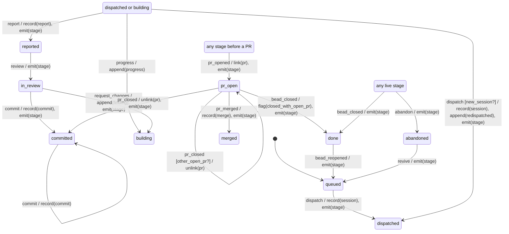

# beads-board: design

Status: design pass, 2026-10-17. Nothing built yet. Visual mockup: the "Beads Board design" canvas, https://claude.ai/artifact/BwE6JCfLAQMnSgdEDSSdNg (six artboards: board, ticket sheet, epic, PR panel with merge flow, stage machine, settings).

## 1. What it is

A local Phoenix LiveView app that shows every beads (`bd`) ticket on this machine on one board, with a process stage per ticket that beads itself does not track: dispatched to which session, building, reported, in review, committed, PR open, merged, done. Agents (Claude Code coordinator, pi build sessions) report progress to it through a small CLI. It also shows each project's GitHub PRs in stack order and can merge them, with confirmation.

Beads stays the source of truth for tickets. The app reads beads and never writes to it in the MVP. Everything extra lives in a local Postgres database outside the repos, plus one hand-edited TOML config file.

### MVP scope

1. Discover and read the beads repos listed in config; show a cross-project board (columns = process stages, swimlanes by project or epic, filters by project, epic, type, label, beads status).
2. Ticket detail: beads fields plus the overlay (stage, stage history, session, worktree, branch, report path, PR, agent notes).
3. Epic view: child tickets, blocking graph, progress.
4. Process stage per ticket, driven by a state machine, updated by agents through the `board` CLI and by observed facts (beads closed, PR opened or merged).
5. PR panel per project: open PRs in stack order, check and mergeable status, linked beads, a merge action that respects the stack and asks for confirmation.
6. Settings view: the loaded config, where it came from, whether it validated, and a reload button.

### Non-goals (MVP)

- Writing to beads (create, update, close, notes). Section 10 keeps the path open.
- Editing tickets in the UI. It is a dashboard.
- Launching or steering pi/tmux sessions. The board records what `dispatch` did; it does not do it.
- Multi-user, auth beyond a local token, remote hosting.
- Squash or rebase merges, creating PRs, reviewing PR diffs.
- Starting Dolt servers for repos in server mode.

## 2. Facts this design rests on (checked 2026-10-17)

| Fact | Consequence |
|---|---|
| Six beads repos under `~/dev`: dotfiles (3 issues), music/form-engine (30), utils/skills (15), wow-addons/cooldown-o-matic (47), wow-addons/we_go_next_dev (unknown), wow-addons/ui-o-matic (417). No others at depth 9. | Small data. A full re-read per repo is cheap enough. |
| `bd` 1.1.0. Five repos use embedded Dolt. **we_go_next_dev is in Dolt server mode** (`dolt_mode: server`, `dolt.auto-start: false`), and its server is down, so `bd list` fails there. | The reader must treat "unreachable" as a normal repo state and never start a server (dispatch skill rule too). |
| **cooldown-o-matic and we_go_next_dev have no `.beads/issues.jsonl`**, and the export hook is only in dotfiles, form-engine and skills. Where it exists, `issues.jsonl` lags the live store until the next commit. | Read the live store through `bd`, not the JSONL file. |
| `bd export` prints one JSON object per issue, with labels, dependencies and comments, in one call (~0.5 s for form-engine). `bd list --json --all` omits comments; `bd show --json` is per issue. | Use `bd export` as the single read per repo. |
| **Reads write to the store.** `bd list` rewrites `.beads/embeddeddolt/<db>/.dolt/noms/manifest` and the journal; `bd show` also rewrites `.beads/last-touched`. All are gitignored. `interactions.jsonl` records only status, priority and assignee changes, not creates or notes. | No file in `.beads/` is a clean "something was written" signal, and watching the Dolt files would trigger on our own reads. Change detection is polling plus content hash, accelerated by cheap signals and explicit pings (section 4.3). |
| Statuses: open, in_progress, blocked, deferred, closed, pinned, hooked. Types in use: task, feature, bug, epic, decision, chore, convoy. Dependency types in use: parent-child, blocks, related, discovered-from, tracks, supersedes. Ids are hierarchical (`fe-813.4`, `cdo-uha.2.4.5`); prefixes are unique per repo (`dot`, `fe`, `sk`, `cdo`, `we`, `wow`). | Ticket key = (repo, bead id). A CLI can resolve the repo from the id prefix. |
| Remotes: form-engine, dotfiles, skills use SSH (`git@github.com:rpmessner/…`); ui-o-matic and we_go_next_dev use HTTPS; **cooldown-o-matic has no remote**. No PRs are open right now. form-engine's PRs #1 to #3 were a stack (`pr/platform-seam` to main, `pr/launchkey-hardware` on it, `pr/zig-kit` on that), branch names `pr/<slug>`, bead id in the title. Local branches `pr/time-model` and `pr/scheduler` are the likely next PRs (today `pr/scheduler` is not based on `pr/time-model`; the mockup draws them as a stack for illustration). | Parse both remote forms; GitHub is optional per repo. PR-to-bead linking by id in title, branch or body. |
| `gh` 2.45.0, logged in. `gh pr merge -d` also deletes the **local** branch and runs git in the cwd. `--match-head-commit` exists. | Call the GitHub API directly with `Req`, not `gh pr merge`; take the token from `gh auth token` at boot. |
| Elixir 1.19.5 and Erlang 28.4.2 via asdf (`elixir --version` says "compiled with Erlang/OTP 26"; works, but worth a rebuild some day). `phx_new` 1.8.7 archive installed. PostgreSQL 16 running (cluster `16/main`, port 5432). gw2 pins Phoenix 1.8.7, LiveView 1.1.31, Oban 2.23.0, Ecto SQL 3.14.0, Req 0.6.1. | Nothing is missing. Use the same versions as gw2. |

## 3. Architecture

```
            ~/.config/beads-board/board.toml   (declarative config, hand-edited)
                         | file watch + validate
                         v
  bd export --------> Board.Beads (read model) ----+
  (per repo, Oban)                                  |      Phoenix.PubSub "board:*"
                                                    +----> LiveViews: Board, Ticket, Epic, PRs, Settings
  GitHub REST/GraphQL -> Board.GitHub (PR cache) --+
  (Req, Oban)                                       |
                                                    |
  board CLI ---HTTP---> BoardWeb.API -> Board.Stage (pure FSM) -> Board.Overlay (Postgres, authoritative)
  (agents)              (token)          step/3 -> effects          stage, events, sessions, notes, PR links
```

- **Phoenix 1.8 + LiveView 1.1**, bound to `127.0.0.1:4747` only. Started like gw2 (`mix phx.server` or a release under a user systemd unit; open question 6).
- **Postgres** database `beads_board_dev`, local. Two kinds of table (section 5): a projection of beads (derived, droppable) and the overlay (authoritative).
- **Oban** (Postgres engine) for every external read and write: `RepoSyncJob` (unique per repo), `GitHubSyncJob` (unique per repo), `MergeJob`, `RetargetJob`. Oban gives retries, uniqueness, a timeout per job and a record of what ran. Cron: full beads sweep every 5 min, GitHub sweep every 2 min.
- **`Board.Watch`**, one small GenServer: every 3 s it stats the cheap signals per repo (section 4.3) and enqueues a `RepoSyncJob` when one moved. It holds no ticket state.
- **Pure core, effects at the edge.** `Board.Stage` and the UI machines are pure (`step/3`). The overlay context runs the effects inside a transaction, then broadcasts after commit.

### Module map

| Module | Job |
|---|---|
| `Board.Config` | Load, validate and hot-swap `board.toml`. |
| `Board.Fsm` | The house state-machine macro (section 6). Copied into this repo; extract when a second repo needs it. |
| `Board.Beads.Reader` | Runs `bd export` in a repo (`System.cmd("bd", ["export"], cd: path)`, timeout 20 s), decodes, normalises. The only module that knows bd's JSON shape. |
| `Board.Beads` | Upserts the projection for one repo from a reader result; computes ready and blocked from edges; broadcasts diffs. |
| `Board.Stage` | The ticket process-stage machine. |
| `Board.Overlay` | Ecto context for stages, events, sessions, notes; `apply_event/3` is the one way a stage changes. |
| `Board.GitHub` | Req client (REST + one GraphQL query per repo for PRs and checks), stack ordering, PR-to-bead linking. |
| `Board.Merge` | The merge-action machine (UI) and `MergeJob`. |
| `BoardWeb.API` | JSON API for the CLI. |
| `board` (escript, `cli/`) | Agent-facing CLI. |

## 4. Reading beads

### 4.1 Source: `bd export`, not `issues.jsonl`

| | `bd export` (chosen) | `.beads/issues.jsonl` |
|---|---|---|
| Fresh | Live store | Only as of the last commit |
| Present in every repo | Yes, where bd can open the store | No (missing in two repos) |
| Includes comments, labels, deps | Yes | Yes |
| Works when Dolt server is down | No: repo shows "unreachable" | Yes, if the file exists |
| Side effects | Rewrites gitignored Dolt manifest/journal | None |

Fallback: when `bd export` fails and `issues.jsonl` exists, read the file and mark the repo "stale snapshot (as of commit X)". That keeps we_go_next_dev visible if it ever gains an export, without starting its server.

Never `String.to_atom` on bd output: statuses, types and dependency types map through explicit lookup tables (`"in_progress" -> :in_progress`); unknown values become `{:unknown, "raw"}` and render as a grey badge, so a new bd status never crashes the sync.

### 4.2 Concurrency with agents writing

An agent may run `bd update` while the board runs `bd export` against the same embedded store. Whether embedded Dolt serialises this or one side gets a lock error is not verified. **Probe before building** (ticket S1): run `bd export` in a loop while another shell runs `bd note` in a loop, in a scratch copy of a repo, and record errors. If the writer can fail, the reader must back off (lower poll rate, `bd` lock file check) rather than make agents' writes flaky. The board must never cause an agent's bd write to fail.

### 4.3 Noticing changes

Every source of truth is polled; nothing is written into the repos (no git hook, no bd hook).

1. **Cheap signals, every 3 s** (`Board.Watch`, `File.stat` only): mtime of `.beads/issues.jsonl`, `.beads/interactions.jsonl`, `.git/HEAD` and the ref it points at. Any change enqueues a sync.
2. **Pings**: every `board` CLI write also asks for a sync of that repo, so agent work shows within a second or two.
3. **Sweep**: Oban cron re-reads every enabled repo every 5 min, which catches human `bd` edits that touch none of the signals (creates, notes).
4. **Idempotent**: the sync hashes the export (`:crypto.hash(:sha256, output)`); an unchanged hash ends the job without touching the database. The projection upsert is per repo in one transaction; beads that vanished are deleted from the projection, and their overlay rows are marked `orphaned_at`, never deleted.

Rejected: watching `.beads/embeddeddolt` (our own reads rewrite it, so it would loop) and a git hook ping (adds a file to every repo and misses uncommitted bd writes).

## 5. Data model

Rule: **a field lives where its writer is.** Beads owns ticket content; the overlay owns process facts that beads does not know; config owns hand-edited presentation and wiring.

### 5.1 Config file (hand-edited, declarative)

`board.toml` (section 7). Repo list and paths, GitHub repo per project, board columns, status-to-stage defaults, colours and labels, per-epic display options. Not in Postgres because it changes rarely, is edited by a human, and should diff in version control.

### 5.2 Beads projection (derived; truncate and rebuild any time)

| Table | Fields | Notes |
|---|---|---|
| `repos` | `key` (from config), `path`, `project_id` (from `.beads/metadata.json`), `prefix`, `bd_mode`, `github` (owner/name or null), `default_branch`, `sync_status` (`ok`/`syncing`/`unreachable`/`stale_snapshot`), `sync_error`, `export_sha256`, `synced_at` | One row per configured repo. `project_id` is the stable identity if a repo moves. |
| `beads` | `repo_id`, `bead_id`, `title`, `status`, `issue_type`, `priority`, `assignee`, `owner`, `labels` (text[]), `description`, `acceptance_criteria`, `notes`, `close_reason`, `parent_bead_id`, `created_at`, `updated_at`, `started_at`, `closed_at`, `raw` (jsonb) | `raw` keeps the whole record so new bd fields need no migration to display. |
| `bead_edges` | `repo_id`, `from_bead_id`, `to_bead_id`, `type` | From `dependencies`. `blocks` drives ready and blocked; `parent-child` drives epics. |
| `bead_comments` | `repo_id`, `bead_id`, `author`, `body`, `created_at` | From export. |

Derived, not stored: `ready?` (open, every `blocks` target closed), epic progress.

### 5.3 Overlay (authoritative; back it up)

| Table | Fields | Why here |
|---|---|---|
| `tickets` | `repo_key`, `bead_id`, `stage` (enum of `Board.Stage` states), `stage_changed_at`, `lock_version`, `orphaned_at` | Beads has no process stage. Keyed by `(repo_key, bead_id)`, not a projection foreign key, so a projection rebuild never touches it. |
| `stage_events` | `ticket_id`, `event`, `payload` (jsonb), `source` (`claimed` / `observed` / `backfill`), `actor` (`claude`, `pi`, `user`, `github`, `beads`), `from_stage`, `to_stage`, `outcome` (`row`/`ignored`/`invalid`), `effects` (jsonb), `inserted_at` | Append-only history; audit trail and the input to any later replay. Invalid claims are logged too, so a confused agent is visible. |
| `sessions` | `window`, `harness` (`pi`/`claude`), `model`, `workdir`, `branch`, `base_sha`, `brief_path`, `report_path`, `marker`, `started_at`, `last_seen_at`, `ended_at` | Mirrors the `dispatch` skill's slots (window, workdir, brief, report, base sha, marker). |
| `ticket_sessions` | `ticket_id`, `session_id`, `role` (`build` / `review`) | One session can carry several tickets (dispatch groups tickets that share files). |
| `agent_notes` | `ticket_id`, `session_id`, `actor`, `kind` (`progress` / `finding` / `report` / `note`), `body`, `inserted_at` | Agents' running commentary. Kept out of beads on purpose (beads `notes` are for durable facts). |
| `pull_requests` | `repo_key`, `number`, `title`, `head_ref`, `head_sha`, `base_ref`, `state`, `draft`, `mergeable`, `checks` (`pass`/`fail`/`pending`/`none`), `url`, `synced_at` | Cache of GitHub, refreshed by sync; needed for stack order and the merge guard. |
| `pr_links` | `pull_request_id`, `ticket_id`, `source` (`title`/`branch`/`body`/`manual`) | A PR can close several beads; a ticket can have several PRs. |
| `merge_actions` | `pull_request_id`, `requested_by`, `head_sha`, `retarget_child`, `state`, `error`, timestamps | Audit of every merge the board performed. |

Stage for tickets first seen: a closed bead gets `done` and an open bead gets `queued`, through a `backfill` event so history says why.

Epics get no stage. Their board card shows children's progress (closed / total) and a stage histogram.

## 6. The state-machine DSL: `Board.Fsm`

House principle `state-machine-skeleton`, Elixir row: own pure table plus a validator macro, `:gen_statem` only for long-lived processes that need state timeouts. Concepts match form-engine's `core/fsm.zig` (rows, groups, `any`, `stay`, explicit `ignore` and `invalid`, specificity ranking, compile-time coverage); the syntax is Elixir declarations.

### 6.1 Vocabulary

| Declaration | Meaning |
|---|---|
| `initial :s` | Start state (exactly one). |
| `state :s, enter: [...], exit: [...]` | A state and its entry/exit effects. |
| `group :g, [:a, :b]` | A named set of states, usable in `from:`. Hierarchy is only ever this. |
| `event :e, source: :claimed \| :observed` | An event. `claimed` events come from agents and the UI; `observed` events are facts read from beads or GitHub. |
| `guard :g?` | Declares a guard. Must match a `def g?(data, payload)` in the module that returns a boolean. |
| `effects [:record, ...]` | The effect names the adapter handles. Anything else in a row is a compile error. |
| `transition :e, from: f, to: t, guard: g, do: [...]` | A row. `from` is a state, a group, a list, or `:any`. `to` is a state or `:stay`. `do` is a keyword list of effects. |
| `ignore :e \| [..], from: f` | A legal event that means nothing in those states. |
| `invalid :e \| [..], from: f` | A pair that should not happen; `step/3` returns an error the caller reports. |

Row resolution for a pair (state, event), same as the Zig kit: candidates are the rows naming both; order them by how specifically they name the state (one, then a group or list, then `:any`), then the event the same way, then declaration order; take the first whose guard holds.

### 6.2 Compile-time checks

`@before_compile` raises `CompileError` (with the row's file and line) when:

1. a row names an undeclared state, event, group, guard or effect;
2. `initial` is missing or declared twice; a state, event or group is declared twice;
3. a declared guard has no `def name(data, payload)`;
4. some (state, event) pair has no candidate row (add a row, `ignore` or `invalid`);
5. every candidate for a pair is guarded (needs an unguarded row after them);
6. two candidates of a pair have equal rank and equal guard (duplicate transition);
7. a row is never used: more specific or earlier rows decide every pair it names (dead row);
8. a state is unreachable from `initial`;
9. an `ignore` or `invalid` row has effects;
10. an `observed` event is `invalid` anywhere (facts are never refused; ignore them instead).

Check 10 is a board-specific rule expressed as an option (`use Board.Fsm, observed_never_invalid: true`), not hard-coded.

### 6.3 What it generates

- `step(state, event, data) :: {next_state, [effect]} | {:error, {:invalid, state, event}}`. Pure and total. `event` is an atom or `{atom, payload}`. Ignored pairs return `{state, []}`. Effects are `{name, arg}` tuples in order: exit effects, row effects, entry effects (exit and entry only when the state changes).
- `__fsm__(:states | :events | :groups | :rows | :initial)` for introspection, tests and the UI (allowed next events per state).
- `to_mermaid/0` and `matrix/0` (strings). `mix board.fsm.docs` writes `docs/machines/<name>.md`; a test fails when the committed file differs from a fresh render, so a behaviour change always shows in the diff.

### 6.4 Prototype: the ticket process stage

Prototype snippet, not final code.

```elixir
defmodule Board.Stage do
  @moduledoc "Process stage of one ticket. Beads owns the ticket; this owns where it is in the house workflow."
  use Board.Fsm, observed_never_invalid: true

  initial :queued

  state :queued
  state :dispatched
  state :building
  state :reported
  state :in_review
  state :committed
  state :pr_open
  state :merged, enter: [suggest: :close_bead]
  state :done
  state :abandoned

  group :live, [:queued, :dispatched, :building, :reported, :in_review, :committed, :pr_open, :merged]
  group :pre_pr, [:queued, :dispatched, :building, :reported, :in_review, :committed]
  group :working, [:dispatched, :building]
  group :after_report, [:reported, :in_review, :committed, :pr_open, :merged]

  # Claimed: sent by agents (board CLI) or the UI. Refused when out of order.
  event :dispatch, source: :claimed
  event :progress, source: :claimed
  event :report, source: :claimed
  event :review, source: :claimed
  event :request_changes, source: :claimed
  event :commit, source: :claimed
  event :abandon, source: :claimed
  event :revive, source: :claimed

  # Observed: facts from GitHub or beads. Never refused.
  event :pr_opened, source: :observed
  event :pr_closed, source: :observed
  event :pr_merged, source: :observed
  event :bead_closed, source: :observed
  event :bead_reopened, source: :observed

  effects [:record, :append, :link, :unlink, :flag, :suggest, :emit]

  guard :new_session?
  guard :other_open_pr?

  #           event             from            to            guard / effects
  transition :dispatch,        from: :queued,  to: :dispatched, do: [record: :session, emit: :stage]
  transition :dispatch,        from: :working, to: :dispatched, guard: :new_session?,
                                                                do: [record: :session, append: :redispatched, emit: :stage]
  transition :progress,        from: :working, to: :building,   do: [append: :progress]
  transition :progress,        from: :after_report, to: :stay,  do: [append: :progress]
  transition :report,          from: :working, to: :reported,   do: [record: :report, emit: :stage]
  transition :review,          from: :reported, to: :in_review, do: [emit: :stage]
  transition :request_changes, from: :in_review, to: :building, do: [append: :finding, emit: :stage]
  transition :commit,          from: :in_review, to: :committed, do: [record: :commit, emit: :stage]
  transition :commit,          from: :committed, to: :stay,     do: [record: :commit]
  transition :abandon,         from: :live,    to: :abandoned,  do: [emit: :stage]
  transition :revive,          from: :abandoned, to: :queued,   do: [emit: :stage]

  transition :pr_opened,       from: :pre_pr,  to: :pr_open,    do: [link: :pr, emit: :stage]
  transition :pr_opened,       from: [:pr_open, :merged], to: :stay, do: [link: :pr]
  transition :pr_closed,       from: :pr_open, to: :stay,       guard: :other_open_pr?, do: [unlink: :pr]
  transition :pr_closed,       from: :pr_open, to: :committed,  do: [unlink: :pr, emit: :stage]
  transition :pr_merged,       from: :pr_open, to: :merged,     do: [record: :merge, emit: :stage]
  transition :bead_closed,     from: :pr_open, to: :done,       do: [flag: :closed_with_open_pr, emit: :stage]
  transition :bead_closed,     from: :live,    to: :done,       do: [emit: :stage]
  transition :bead_reopened,   from: :done,    to: :queued,     do: [emit: :stage]

  # Written down, not silent: facts that change nothing here, claims that are out of order.
  ignore  [:pr_opened, :pr_closed, :pr_merged, :bead_closed, :bead_reopened], from: :any
  invalid [:dispatch, :progress, :report, :review, :request_changes, :commit, :abandon, :revive], from: :any

  def new_session?(data, payload), do: payload.window != data.session_window
  def other_open_pr?(data, payload), do: Enum.any?(data.open_prs, &(&1 != payload.number))
end
```

Pure use, and the adapter:

```elixir
iex> Board.Stage.step(:building, {:report, %{path: "docs/sessions/fe-loop.md"}}, data)
{:reported, [record: :report, emit: :stage]}

iex> Board.Stage.step(:pr_open, :review, data)
{:error, {:invalid, :pr_open, :review}}          # API answers 409: "fe-813.4 is pr_open; review not accepted"

iex> Board.Stage.step(:abandoned, {:pr_merged, %{number: 6}}, data)
{:abandoned, []}                                  # ignored, logged with outcome "ignored"

# Board.Overlay.apply_event/3: lock the ticket row, step, insert stage_event,
# update stage, run DB effects (record/append/link/unlink/flag) in the same
# transaction; after commit run :emit (PubSub) and :suggest (UI hint).
```

Why the stage machine has no timeouts: "session went quiet" changes no handled event, so per the OTP rule it is data, not state. The board shows a "stale" badge when `sessions.last_seen_at` is older than the configured threshold. No machine in the MVP runs under `:gen_statem`; the DSL leaves room for a `timeout` row kind (an effect `{:arm_timeout, name, ms}` plus a row on the `:timeout` event) for the first machine that needs one.

### 6.5 Generated doc (excerpt of `docs/machines/stage.md`)

The diagram draws a row declared over a named group once, from a pseudo-state labelled with the group, and leaves group stay rows to the matrix; the matrix stays exact, one line per (state, event). The canvas artboard "Stage machine, generated" is this diagram laid out by hand.



| state | event | result | effects |
| --- | --- | --- | --- |
| queued | dispatch | -> dispatched | record(session), emit(stage) |
| queued | progress | invalid | |
| queued | pr_opened | -> pr_open | link(pr), emit(stage) |
| building | dispatch [new_session?] | -> dispatched | record(session), append(redispatched), emit(stage) |
| building | dispatch | invalid | |
| pr_open | review | invalid | |
| pr_open | pr_closed [other_open_pr?] | stay | unlink(pr) |
| pr_open | pr_closed | -> committed | unlink(pr), emit(stage) |
| pr_open | bead_closed | -> done | flag(closed_with_open_pr), emit(stage) |
| merged | (enter) | | suggest(close_bead) |
| abandoned | pr_merged | ignored | |
| ... | | | (10 states x 13 events = 130 lines, plus guarded alternatives) |

### 6.6 Other machines in the MVP

- **`Board.Merge.Action`** (PR panel, pure, held in the LiveView assign): `idle`, `confirming`, `merging`, `retargeting`, `merged`, `failed`. `request` from `idle` goes to `confirming` only under guard `mergeable_now?` (bottom of stack, checks pass, not draft, mergeable), else stays `idle` with `{:toast, reason}`. `confirm` goes to `merging` under `head_unchanged?` (enqueue `MergeJob` with the head sha), else back to `confirming` with a "head moved, re-check" warning. `merge_ok` goes to `retargeting` when a child PR exists, else `merged`. `merge_failed` and `job_timeout` (the job's own Oban timeout, 60 s) go to `failed`. Shown live in the mockup.
- **Repo sync status** is data (`sync_status` column), not a machine: it does not change which events are handled.

## 7. Config: one TOML file

### 7.1 The split

| Kind | Where | Examples |
|---|---|---|
| Declarative, hand-edited, slow | `board.toml` | Repos and paths, GitHub repo per project, enabled flag, board columns (which stages, in what order, titles), default stage for beads statuses on backfill, colours and labels, swimlane default, stale-session threshold, per-epic display options (pin, collapse, colour). |
| Live, written by agents and the UI | Postgres overlay | Stage per ticket, events, sessions, notes, PR links, merge audit. |
| Behaviour | Code (`Board.Stage`) | States, events, transitions. |

Config may **name** stages and events but cannot define or change them. `Board.Config` validates every stage name against `Board.Stage.__fsm__(:states)`; a column naming an unknown stage is a load error. That keeps the state machine's compile-time checks meaningful: a typo in TOML cannot invent a stage.

Rejected for config: YAML front matter in markdown (good for per-document metadata, poor for a typed config with tables of repos), and YAML (whitespace-sensitive, `no` becomes false). TOML matches `utils/skills/catalog.toml`.

### 7.2 Where the file lives

**Recommended: one global file, `~/.config/beads-board/board.toml`, kept in dotfiles like the other `~/.config/<tool>` dirs.** It diffs and travels in version control, and the repos stay clean. Two constraints from the house setup:

- dotfiles is pushed to GitHub and the commit hook blocks local operator paths, so paths in it are `~`-relative (`path = "~/dev/music/form-engine"`), expanded at load.
- Machine-specific overrides go in an untracked `~/.config/beads-board/board.local.toml` (same convention as `~/.zshrc.local`), merged over the main file.

Not recommended for the MVP: per-repo `.beads/board.toml`. It travels with the code but adds a file to every repo, and the user wants no board cruft in repos. The loader can accept one later as a lower-priority layer without changing the schema.

Defaults ship in the app (`priv/board.defaults.toml`), so the user file only holds what differs.

### 7.3 Reload

`Board.Config` watches the directory (not the file: editors save by rename) with `file_system` (inotify; works under `/home` on WSL2). `file_system` already arrives with `phoenix_live_reload`, but only in dev, so it is declared explicitly for runtime use (same version, no new transitive tree). On change: parse, validate, and only then swap (`:persistent_term`) and broadcast `config:changed`; on error keep the last good config and show the error in Settings. Settings also has a Reload button and shows the file path, last load time and validation result.

### 7.4 Shape

```toml
# ~/.config/beads-board/board.toml
[board]
swimlanes = "project"           # project | epic | none
stale_session_after = "2h"

[[columns]]
title  = "Queued"
stages = ["queued"]
[[columns]]
title  = "In flight"
stages = ["dispatched", "building"]
[[columns]]
title  = "Review"
stages = ["reported", "in_review"]
[[columns]]
title  = "Shipping"
stages = ["committed", "pr_open", "merged"]
[[columns]]
title  = "Done"
stages = ["done"]
collapsed = true

[backfill]                       # stage given to a bead the board sees for the first time
closed = "done"
default = "queued"

[[repos]]
key    = "form-engine"
path   = "~/dev/music/form-engine"
github = "rpmessner/form-engine"
color  = "violet"

[[repos]]
key     = "we_go_next_dev"
path    = "~/dev/games/wow-addons/we_go_next_dev"
github  = "rpmessner/we_go_next_dev"
enabled = true                   # shows "unreachable" until its Dolt server runs

[epics."fe-813"]
pin = true
```

Repo discovery: the Settings view lists `.beads` dirs found under `~/dev` that are not in the config yet, with the TOML block to paste. The app does not write the config file.

## 8. Agent tools

### 8.1 Options

| Option | For | Against |
|---|---|---|
| **`board` CLI over a local HTTP API** (recommended) | Claude Code and pi both run shell commands; nothing harness-specific. Easy to put in a brief. Same verbs a human can type. Testable. | Needs the app's HTTP API (wanted anyway) and an installed escript. |
| MCP server | Typed tools in Claude Code. | Claude-specific setup per harness; pi support unverified; another long-running process. |
| HTTP API only (curl) | No install. | Agents hand-write JSON; error-prone; noisy briefs. |
| Skill only | Teaches when to call. | A skill still needs a tool to call. |

**Recommendation: the HTTP API plus a `board` escript, taught by a short `board` skill in utils/skills.** The skill says which verb to run at which workflow step; the CLI does the work. An MCP wrapper can be added later over the same API if Claude-side typed tools prove worth it.

### 8.2 CLI behaviour

- Built from this repo (`mix escript.build` in `cli/`), installed to `~/.local/bin/board` by the user.
- Talks to `http://127.0.0.1:4747/api` with a bearer token read from `~/.local/state/beads-board/token` (created by the app on first boot, mode 600, outside any repo).
- Resolves the repo from the bead id prefix; `--repo` overrides.
- `--actor` defaults from `BOARD_ACTOR` (`claude`, `pi`), `--session` from `BOARD_SESSION` (the tmux window name). The dispatch brief sets both.
- **Never blocks an agent.** If the app is down, the CLI appends the request to `~/.local/state/beads-board/spool.jsonl`, prints a one-line warning and exits 0; the app replays the spool on boot. Out-of-order claims exit 3 with the reason (stage, allowed events), so an agent sees it and the coordinator can decide.
- `--json` on every command for scripts.

### 8.3 Commands per workflow step

| Step (flow skill) | Who | Command |
|---|---|---|
| tight-spec, to-tickets | coordinator | none: tickets appear from beads within a sync |
| dispatch | coordinator | `board dispatch fe-813.4 --window fe-loop --harness pi --model gpt-6-astra --workdir ~/dev/music/form-engine --branch pr/looper --base 460b13a --brief docs/briefs/fe-loop.md --report docs/sessions/fe-loop.md` (several ids allowed for a grouped window) |
| build | pi session | `board progress fe-813.4 "count-in and record work; loop wrap next"` |
| report | pi session | `board report fe-813.4 --path docs/sessions/fe-loop.md` |
| verify and review | coordinator | `board review fe-813.4`; findings back: `board changes fe-813.4 "Important: loop length not rounded to bars"` |
| commit | coordinator | `board commit fe-813.4 --sha 9c1e2f0` |
| stacked PR | coordinator / user | none: observed from GitHub (bead id in title or branch). Fix a miss with `board link fe-813.4 --pr 6` |
| merge | user | in the PR panel |
| close bead | coordinator | `bd close fe-813.4 --reason ...` as today; the board observes it |
| any | anyone | `board show fe-813.4` (stage, session, allowed next events), `board ls --stage building` |

### 8.4 HTTP API

`POST /api/tickets/:repo/:bead_id/events` with `{"event": "report", "payload": {...}, "actor": "pi", "session": "fe-loop"}` returns `200 {stage, effects}`, `409 {stage, allowed}` for invalid claims, `404` for unknown beads (after one forced sync). `GET /api/tickets/:repo/:bead_id`. `POST /api/repos/:repo/sync`. Observed events are not accepted from the API: only the beads and GitHub syncs produce them.

## 9. GitHub and merge safety

- Token: `gh auth token` read once at boot into application env, never logged or stored. Requests go through `Req` (REST for merge and retarget, GraphQL for the PR list with `headRefOid`, `baseRefName`, `mergeable`, `mergeStateStatus`, `isDraft`, and the check rollup).
- Remote parsing handles `git@github.com:o/r.git` and `https://github.com/o/r.git`; `github = ...` in config overrides; no remote means no PR panel (cooldown-o-matic).
- **Stack order:** a PR whose base is another open PR's head is its child. Chains are ordered from the default branch up. A PR whose base is neither the default branch nor an open PR's head is shown as "detached base" and cannot be merged from the board.
- **Linking:** bead ids matched against the repo's prefix (`\bfe-[a-z0-9]+(?:\.\d+)*\b`) in title, then branch, then body. Each link records its source.
- **Merge rules** (all enforced server-side in `MergeJob` too, not only in the UI):
  1. Only the bottom PR of a stack (base = default branch) can be merged. Others show "merge #N first".
  2. Not draft, checks passing or absent, GitHub `mergeable` true.
  3. Merge commits only (`merge_method: "merge"`), with `sha: head_sha` so GitHub refuses if the head moved after the user confirmed.
  4. Confirmation dialog names the PR, base, head sha, linked beads, and the follow-up: "then retarget #N+1 onto main".
  5. After merge, `RetargetJob` sets the child PR's base to the default branch (`PATCH /pulls/:n {base}`), so the next merge is again bottom-of-stack. No branch deletion in the MVP (open question 4).
  6. The board never runs local git; it does not touch worktrees.
- Merge observed: GitHub sync produces `pr_merged` for linked tickets; stage goes to `merged`, and the UI suggests the `bd close` command.

## 10. Fluxon UI without leaking the license

- Fluxon 3.x comes from a private Hex repo. One-time, per machine, the user runs: `mix hex.repo add fluxon https://repo.fluxonui.com --fetch-public-key "$FLUXON_KEY_FINGERPRINT" --auth-key "$FLUXON_LICENSE_KEY"`. Hex stores the key in the user's Hex config, outside the repo.
- The two env vars are exported from the untracked `~/.zshrc.local`, each read from the license files the user keeps with their other secrets (for example `export FLUXON_LICENSE_KEY="$(cat <license file>)"`). This doc, the repo and its README never name those files.
- `mix.exs`: `{:fluxon, "~> 3.0", repo: :fluxon}`. `mix.lock` holds only the package checksum. `deps/` is gitignored by default.
- Wiring per Fluxon's install guide: `use Fluxon` in the web module's `html_helpers`; in `assets/css/app.css` `@source "../../deps/fluxon/**/*.*ex"` and `@import "../../deps/fluxon/priv/static/theme"`; in `assets/js/app.js` spread `FluxonHooks` into the LiveSocket hooks and call `FluxonDOM.onBeforeElUpdated(from, to)`.
- A guard in `mix precommit`: grep the staged tree for the license env values' shape and for the secrets directory name, alongside the global secrets hook.
- Theme: Fluxon's default tokens (zinc neutrals, `light-dark()` dark mode, `--primary` zinc-900 in light and white in dark, Inter). Stage colours come from config, mapped onto Fluxon's semantic colours (`info`, `warning`, `success`, `danger`, neutral) through its `badge` `color` and `variant="soft"`.
- Components used: `navlist` (sidebar), `badge`, `button`, `button_group`, `tabs`, `table`, `sheet` (ticket detail slides over the board), `modal` (merge confirmation), `toast`, `tooltip`, `select`, `tags_input` (label filter), `alert` (repo unreachable), `scroll_area`.

## 11. Path to two-way sync later

The MVP must not foreclose writing to beads. What keeps it open:

1. **One writer per field.** Beads fields are never stored as authoritative in the overlay. A later write goes `UI or agent -> command -> bd CLI -> next sync observes it -> projection`. No dual write, no conflict resolution.
2. **Writes only through `bd`,** never into Dolt files or `issues.jsonl`, so bd's own audit and export keep working.
3. **Effects are already data.** The `merged` state's entry effect is `suggest: :close_bead`. Two-way sync adds an effect kind `{:bd, :close, reason}` and a `Board.Beads.Writer` adapter; the machine changes by a row edit that shows in the golden matrix.
4. **The sync is idempotent and hash-based,** so the echo of our own write is a no-op.
5. **Keys are `(repo_key, bead_id)`,** which `bd` accepts directly.

Writes then need what reads do not: the concurrency probe result from 4.2, a per-repo opt-in in config, and a confirmation in the UI.

## 12. Open questions (with recommended answers)

1. **Config location.** Global `~/.config/beads-board/board.toml` in dotfiles plus untracked `board.local.toml`, or per-repo `.beads/board.toml`? *Recommend global* (section 7.2).
2. **we_go_next_dev runs Dolt in server mode** with auto-start off, against the house rule, and its server is down. *Recommend:* show it as unreachable in the board; migrate it to embedded in a ticket of its own in that repo. The board never starts servers.
3. **cooldown-o-matic** has no remote and its `cdo-uha.6` plans to merge its beads into ui-o-matic. *Recommend:* include it read-only now; drop it from config when the merge lands.
4. **Delete merged branches?** *Recommend no* for the MVP: retarget the child PR instead; branch cleanup stays manual.
5. **Should the `dispatch` skill call `board dispatch` itself** (in `pi-window`)? *Recommend yes,* as a separate skills ticket after the CLI exists, plus `BOARD_ACTOR`/`BOARD_SESSION` in the brief template.
6. **How it runs.** *Recommend* `MIX_ENV=prod` release under a user systemd unit (WSL2 systemd is on, Postgres runs as a service), port 4747, so it is up whenever agents are.
7. **Write auth.** *Recommend* a bearer token for the API (any local process or browser page could otherwise POST a merge to localhost) and LiveView's CSRF for the UI.
8. **Where `Board.Fsm` lives.** *Recommend* in this repo (`lib/board/fsm.ex`), extracted to a shared lib when a second Elixir repo needs it, per the principle.
9. **Stage for historic tickets.** *Recommend* backfill closed beads to `done`, open to `queued`, recorded as `backfill` events.
10. **Ticket in several PRs, or PR for several tickets.** *Recommend* allow both (link table); the ticket's stage follows the `other_open_pr?` guard.

## 13. Proposed build slices (not beads yet)

Vertical slices; each ends with something visible and a passing `mix precommit`.

| # | Slice | Done when | Blocked by |
|---|---|---|---|
| S0 | **Probe: bd concurrency.** Embedded store, `bd export` loop against `bd note` loop in a scratch copy. | Written result: safe, or back-off rule. | none |
| S1 | **Scaffold.** `phx.new` (Phoenix 1.8.7, LiveView 1.1.31), Postgres, Oban, Fluxon wired, `mix precommit` alias, license guard. Empty Fluxon-themed shell with sidebar, dark mode. | App boots at 127.0.0.1:4747; precommit passes; no license material in the tree. | none |
| S2 | **`Board.Fsm` macro** with all section 6.2 checks, `step/3`, Mermaid and matrix, golden-file test, StreamData property test (random event sequences never raise, observed events never invalid). | Each check has a failing-fixture test that asserts the compile error. | none |
| S3 | **Config.** TOML load, validate against `Board.Stage` states, watch and hot swap, Settings view. | Edit the file, the Settings view updates; a bad stage name shows an error and keeps the old config. | S1, S2 (stage names) |
| S4 | **Beads read model.** Reader over `bd export`, projection tables, sync job, watcher, hash skip, unreachable state. Board view with beads status only. | All six repos appear; we_go_next_dev shows unreachable; a `bd note` in form-engine shows within 5 s. | S0, S1, S3 |
| S5 | **Stage overlay.** `Board.Stage`, overlay tables, `apply_event/3`, backfill, board columns from config, ticket detail sheet with history. | Backfilled stages match beads status; events from iex move cards live. | S2, S4 |
| S6 | **Agent API and `board` CLI.** Token, events endpoint, spool when down, `board` skill draft. | A pi session's `board progress` and `board report` move a card; with the app stopped the CLI exits 0 and the spool replays on boot. | S5 |
| S7 | **Epic view.** Children, blocking graph, progress, stage histogram. | `fe-813` renders its 9 children and edges matching `bd graph`. | S5 |
| S8 | **GitHub read.** PR sync, stack order, linking, PR panel read-only, `pr_opened` / `pr_merged` / `pr_closed` events. | A test stack (two draft PRs in a scratch GitHub repo) shows in order with links. | S5 |
| S9 | **Merge action.** `Board.Merge.Action` machine, confirm modal, `MergeJob` with sha guard, `RetargetJob`, audit table. | In the scratch repo: out-of-order refused, bottom PR merges with a merge commit, child retargets to main, stage goes to merged. | S8 |
| S10 | **Dispatch integration** (utils/skills ticket): `pi-window` calls `board dispatch`, brief template sets `BOARD_*`. | A real dispatch shows on the board with window, branch and brief. | S6 |

S1 and S2 can run in parallel; S7 and S8 can run in parallel after S5.
