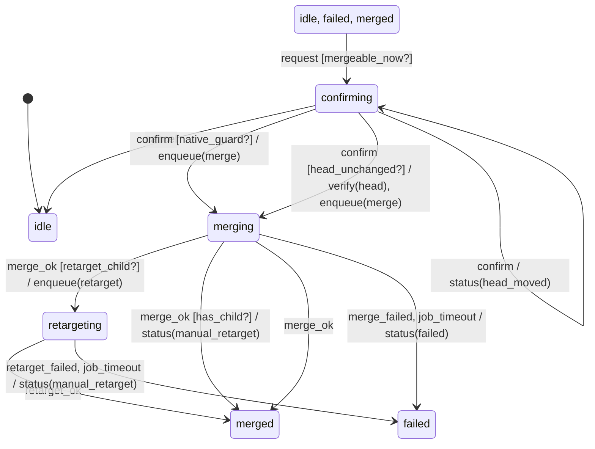

# action

Generated by `mix foreman.fsm.docs`. Do not edit by hand.

| state | event | result | effects |
| --- | --- | --- | --- |
| idle | request [mergeable_now?] | -> confirming |  |
| idle | request | stay | status(refused) |
| idle | cancel | invalid |  |
| idle | confirm | invalid |  |
| idle | merge_ok | invalid |  |
| idle | merge_failed | invalid |  |
| idle | retarget_ok | invalid |  |
| idle | retarget_failed | invalid |  |
| idle | job_timeout | invalid |  |
| confirming | request | invalid |  |
| confirming | cancel | -> idle |  |
| confirming | confirm [native_guard?] | -> merging | enqueue(merge) |
| confirming | confirm [head_unchanged?] | -> merging | verify(head), enqueue(merge) |
| confirming | confirm | stay | status(head_moved) |
| confirming | merge_ok | invalid |  |
| confirming | merge_failed | invalid |  |
| confirming | retarget_ok | invalid |  |
| confirming | retarget_failed | invalid |  |
| confirming | job_timeout | invalid |  |
| merging | request | invalid |  |
| merging | cancel | invalid |  |
| merging | confirm | invalid |  |
| merging | merge_ok [retarget_child?] | -> retargeting | enqueue(retarget) |
| merging | merge_ok [has_child?] | -> merged | status(manual_retarget) |
| merging | merge_ok | -> merged |  |
| merging | merge_failed | -> failed | status(failed) |
| merging | retarget_ok | invalid |  |
| merging | retarget_failed | invalid |  |
| merging | job_timeout | -> failed | status(failed) |
| retargeting | request | invalid |  |
| retargeting | cancel | invalid |  |
| retargeting | confirm | invalid |  |
| retargeting | merge_ok | invalid |  |
| retargeting | merge_failed | invalid |  |
| retargeting | retarget_ok | -> merged |  |
| retargeting | retarget_failed | -> failed | status(manual_retarget) |
| retargeting | job_timeout | -> failed | status(manual_retarget) |
| merged | request [mergeable_now?] | -> confirming |  |
| merged | request | stay | status(refused) |
| merged | cancel | invalid |  |
| merged | confirm | invalid |  |
| merged | merge_ok | invalid |  |
| merged | merge_failed | invalid |  |
| merged | retarget_ok | invalid |  |
| merged | retarget_failed | invalid |  |
| merged | job_timeout | invalid |  |
| failed | request [mergeable_now?] | -> confirming |  |
| failed | request | stay | status(refused) |
| failed | cancel | invalid |  |
| failed | confirm | invalid |  |
| failed | merge_ok | invalid |  |
| failed | merge_failed | invalid |  |
| failed | retarget_ok | invalid |  |
| failed | retarget_failed | invalid |  |
| failed | job_timeout | invalid |  |
