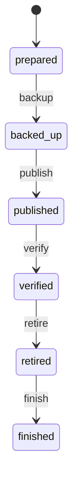

# adopt_machine

Generated by `mix foreman.fsm.docs`. Do not edit by hand.

| state | event | result | effects |
| --- | --- | --- | --- |
| prepared | backup | -> backed_up |  |
| prepared | publish | invalid |  |
| prepared | verify | invalid |  |
| prepared | retire | invalid |  |
| prepared | finish | invalid |  |
| backed_up | backup | invalid |  |
| backed_up | publish | -> published |  |
| backed_up | verify | invalid |  |
| backed_up | retire | invalid |  |
| backed_up | finish | invalid |  |
| published | backup | invalid |  |
| published | publish | invalid |  |
| published | verify | -> verified |  |
| published | retire | invalid |  |
| published | finish | invalid |  |
| verified | backup | invalid |  |
| verified | publish | invalid |  |
| verified | verify | invalid |  |
| verified | retire | -> retired |  |
| verified | finish | invalid |  |
| retired | backup | invalid |  |
| retired | publish | invalid |  |
| retired | verify | invalid |  |
| retired | retire | invalid |  |
| retired | finish | -> finished |  |
| finished | backup | invalid |  |
| finished | publish | invalid |  |
| finished | verify | invalid |  |
| finished | retire | invalid |  |
| finished | finish | invalid |  |
