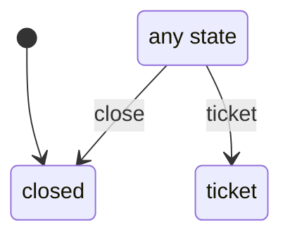

# card_panel

Generated by `mix foreman.fsm.docs`. Do not edit by hand.

| state | event | result | effects |
| --- | --- | --- | --- |
| closed | close | -> closed |  |
| closed | ticket | -> ticket |  |
| ticket | close | -> closed |  |
| ticket | ticket | -> ticket |  |
