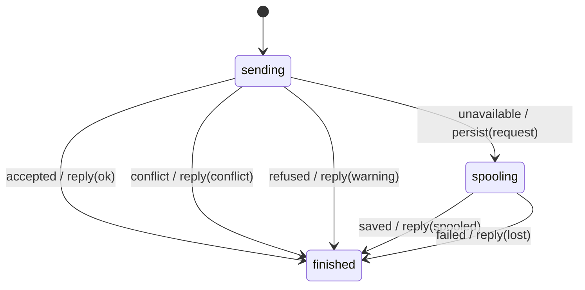

# delivery_machine

Generated by `mix board.fsm.docs`. Do not edit by hand.

| state | event | result | effects |
| --- | --- | --- | --- |
| sending | accepted | -> finished | reply(ok) |
| sending | conflict | -> finished | reply(conflict) |
| sending | refused | -> finished | reply(warning) |
| sending | unavailable | -> spooling | persist(request) |
| sending | saved | invalid |  |
| sending | failed | invalid |  |
| spooling | accepted | invalid |  |
| spooling | conflict | invalid |  |
| spooling | refused | invalid |  |
| spooling | unavailable | invalid |  |
| spooling | saved | -> finished | reply(spooled) |
| spooling | failed | -> finished | reply(lost) |
| finished | accepted | invalid |  |
| finished | conflict | invalid |  |
| finished | refused | invalid |  |
| finished | unavailable | invalid |  |
| finished | saved | invalid |  |
| finished | failed | invalid |  |
