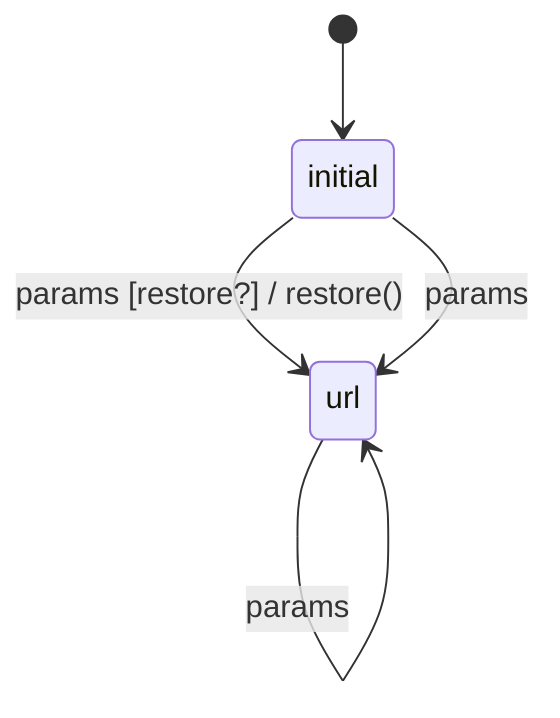

# filter_restore

Generated by `mix foreman.fsm.docs`. Do not edit by hand.

| state | event | result | effects |
| --- | --- | --- | --- |
| initial | params [restore?] | -> url | restore() |
| initial | params | -> url |  |
| url | params | -> url |  |
