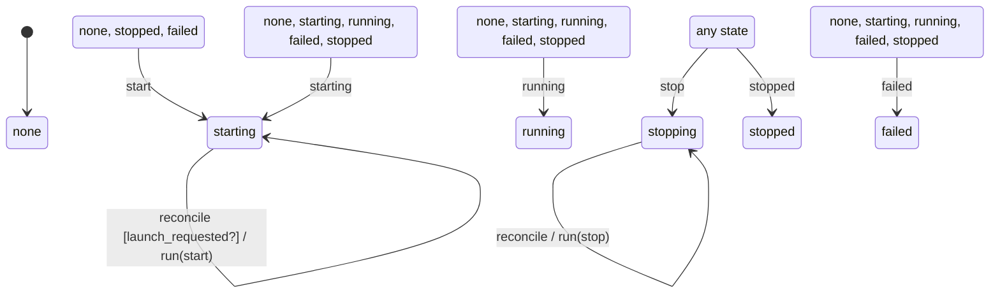

# preview

Generated by `mix foreman.fsm.docs`. Do not edit by hand.

| state | event | result | effects |
| --- | --- | --- | --- |
| none | start | -> starting |  |
| none | stop | -> stopping |  |
| none | starting | -> starting |  |
| none | running | -> running |  |
| none | failed | -> failed |  |
| none | stopped | -> stopped |  |
| none | reconcile | stay | run(observe) |
| starting | start | invalid |  |
| starting | stop | -> stopping |  |
| starting | starting | -> starting |  |
| starting | running | -> running |  |
| starting | failed | -> failed |  |
| starting | stopped | -> stopped |  |
| starting | reconcile [launch_requested?] | stay | run(start) |
| starting | reconcile | stay | run(observe) |
| running | start | invalid |  |
| running | stop | -> stopping |  |
| running | starting | -> starting |  |
| running | running | -> running |  |
| running | failed | -> failed |  |
| running | stopped | -> stopped |  |
| running | reconcile | stay | run(observe) |
| failed | start | -> starting |  |
| failed | stop | -> stopping |  |
| failed | starting | -> starting |  |
| failed | running | -> running |  |
| failed | failed | -> failed |  |
| failed | stopped | -> stopped |  |
| failed | reconcile | stay | run(observe) |
| stopping | start | invalid |  |
| stopping | stop | -> stopping |  |
| stopping | starting | ignored |  |
| stopping | running | ignored |  |
| stopping | failed | ignored |  |
| stopping | stopped | -> stopped |  |
| stopping | reconcile | stay | run(stop) |
| stopped | start | -> starting |  |
| stopped | stop | -> stopping |  |
| stopped | starting | -> starting |  |
| stopped | running | -> running |  |
| stopped | failed | -> failed |  |
| stopped | stopped | -> stopped |  |
| stopped | reconcile | stay | run(observe) |
