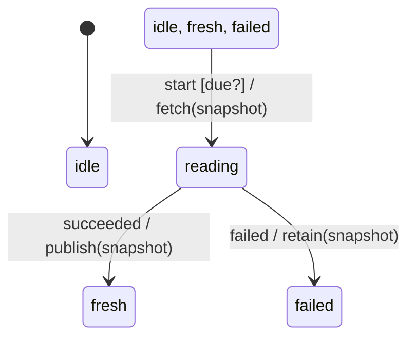

# read_lifecycle

Generated by `mix board.fsm.docs`. Do not edit by hand.

| state | event | result | effects |
| --- | --- | --- | --- |
| idle | start [due?] | -> reading | fetch(snapshot) |
| idle | start | ignored |  |
| idle | succeeded | ignored |  |
| idle | failed | ignored |  |
| reading | start | ignored |  |
| reading | succeeded | -> fresh | publish(snapshot) |
| reading | failed | -> failed | retain(snapshot) |
| fresh | start [due?] | -> reading | fetch(snapshot) |
| fresh | start | ignored |  |
| fresh | succeeded | ignored |  |
| fresh | failed | ignored |  |
| failed | start [due?] | -> reading | fetch(snapshot) |
| failed | start | ignored |  |
| failed | succeeded | ignored |  |
| failed | failed | ignored |  |
