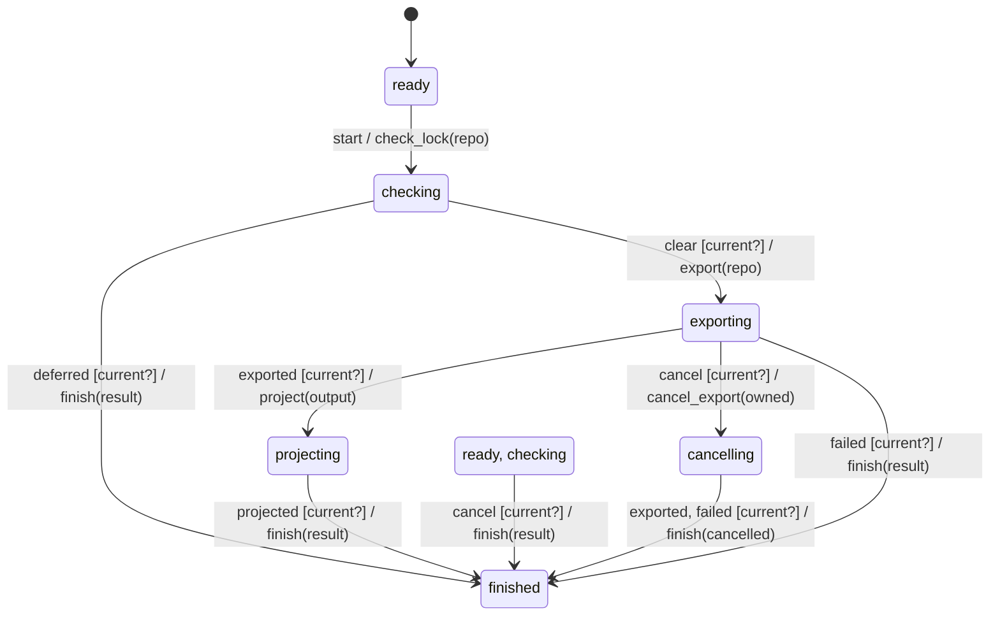

# read_machine

Generated by `mix foreman.fsm.docs`. Do not edit by hand.

| state | event | result | effects |
| --- | --- | --- | --- |
| ready | start | -> checking | check_lock(repo) |
| ready | deferred | ignored |  |
| ready | clear | ignored |  |
| ready | exported | ignored |  |
| ready | projected | ignored |  |
| ready | cancel [current?] | -> finished | finish(result) |
| ready | cancel | ignored |  |
| ready | failed | ignored |  |
| checking | start | ignored |  |
| checking | deferred [current?] | -> finished | finish(result) |
| checking | deferred | ignored |  |
| checking | clear [current?] | -> exporting | export(repo) |
| checking | clear | ignored |  |
| checking | exported | ignored |  |
| checking | projected | ignored |  |
| checking | cancel [current?] | -> finished | finish(result) |
| checking | cancel | ignored |  |
| checking | failed | ignored |  |
| exporting | start | ignored |  |
| exporting | deferred | ignored |  |
| exporting | clear | ignored |  |
| exporting | exported [current?] | -> projecting | project(output) |
| exporting | exported | ignored |  |
| exporting | projected | ignored |  |
| exporting | cancel [current?] | -> cancelling | cancel_export(owned) |
| exporting | cancel | ignored |  |
| exporting | failed [current?] | -> finished | finish(result) |
| exporting | failed | ignored |  |
| cancelling | start | ignored |  |
| cancelling | deferred | ignored |  |
| cancelling | clear | ignored |  |
| cancelling | exported [current?] | -> finished | finish(cancelled) |
| cancelling | exported | ignored |  |
| cancelling | projected | ignored |  |
| cancelling | cancel | ignored |  |
| cancelling | failed [current?] | -> finished | finish(cancelled) |
| cancelling | failed | ignored |  |
| projecting | start | ignored |  |
| projecting | deferred | ignored |  |
| projecting | clear | ignored |  |
| projecting | exported | ignored |  |
| projecting | projected [current?] | -> finished | finish(result) |
| projecting | projected | ignored |  |
| projecting | cancel | ignored |  |
| projecting | failed | ignored |  |
| finished | start | ignored |  |
| finished | deferred | ignored |  |
| finished | clear | ignored |  |
| finished | exported | ignored |  |
| finished | projected | ignored |  |
| finished | cancel | ignored |  |
| finished | failed | ignored |  |
