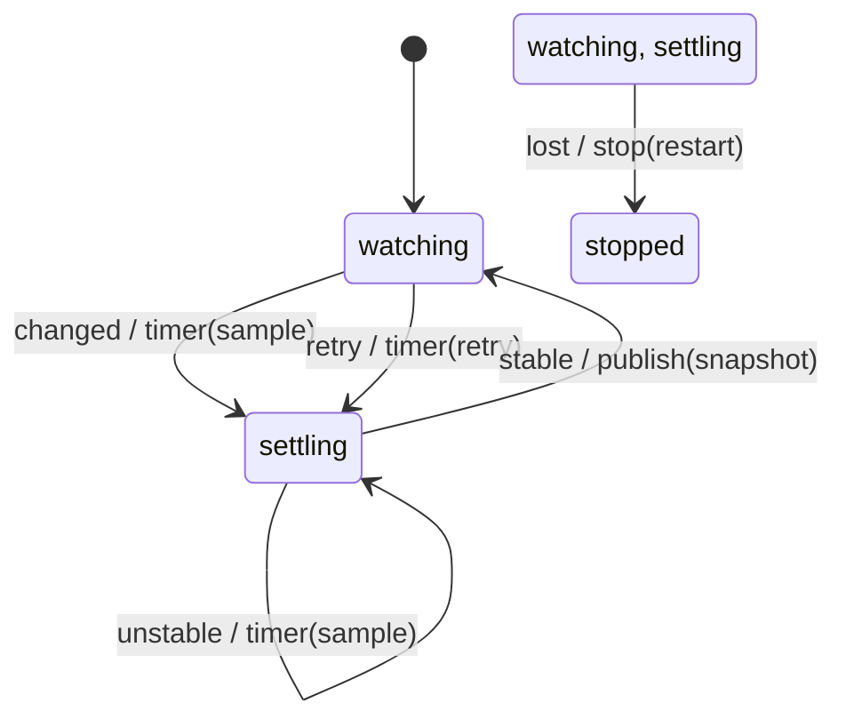

# reader_machine

Generated by `mix foreman.fsm.docs`. Do not edit by hand.

| state | event | result | effects |
| --- | --- | --- | --- |
| watching | changed | -> settling | timer(sample) |
| watching | unstable | ignored |  |
| watching | stable | ignored |  |
| watching | lost | -> stopped | stop(restart) |
| watching | retry | -> settling | timer(retry) |
| settling | changed | ignored |  |
| settling | unstable | stay | timer(sample) |
| settling | stable | -> watching | publish(snapshot) |
| settling | lost | -> stopped | stop(restart) |
| settling | retry | ignored |  |
| stopped | changed | ignored |  |
| stopped | unstable | ignored |  |
| stopped | stable | ignored |  |
| stopped | lost | ignored |  |
| stopped | retry | ignored |  |
