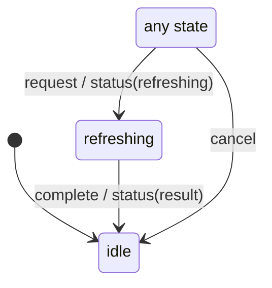

# refresh_status

Generated by `mix board.fsm.docs`. Do not edit by hand.

| state | event | result | effects |
| --- | --- | --- | --- |
| idle | request | -> refreshing | status(refreshing) |
| idle | complete | ignored |  |
| idle | cancel | -> idle |  |
| refreshing | request | -> refreshing | status(refreshing) |
| refreshing | complete | -> idle | status(result) |
| refreshing | cancel | -> idle |  |
