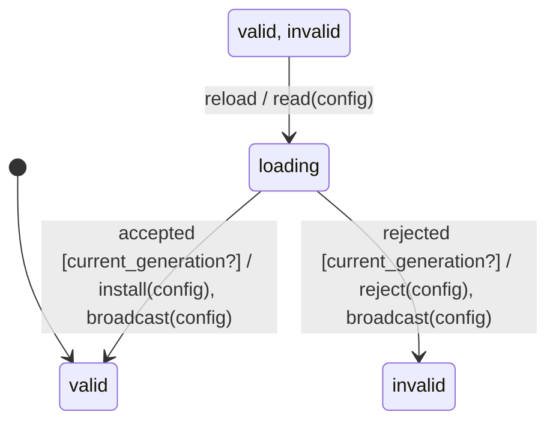

# reload_machine

Generated by `mix foreman.fsm.docs`. Do not edit by hand.

| state | event | result | effects |
| --- | --- | --- | --- |
| valid | reload | -> loading | read(config) |
| valid | accepted | ignored |  |
| valid | rejected | ignored |  |
| loading | reload | ignored |  |
| loading | accepted [current_generation?] | -> valid | install(config), broadcast(config) |
| loading | accepted | ignored |  |
| loading | rejected [current_generation?] | -> invalid | reject(config), broadcast(config) |
| loading | rejected | ignored |  |
| invalid | reload | -> loading | read(config) |
| invalid | accepted | ignored |  |
| invalid | rejected | ignored |  |
