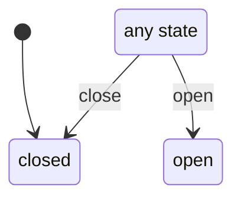

# request_drawer

Generated by `mix foreman.fsm.docs`. Do not edit by hand.

| state | event | result | effects |
| --- | --- | --- | --- |
| closed | open | -> open |  |
| closed | close | -> closed |  |
| open | open | -> open |  |
| open | close | -> closed |  |
