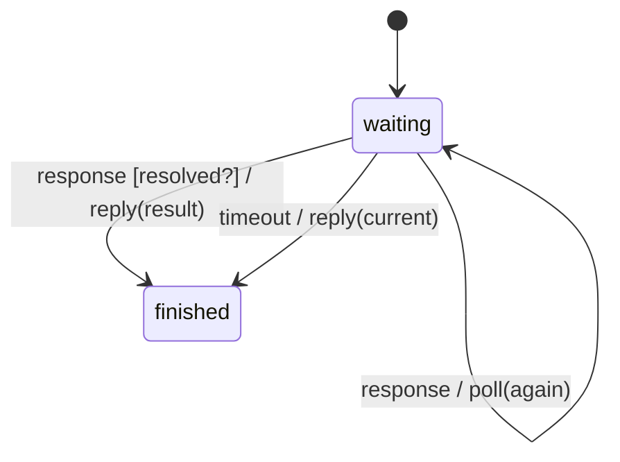

# request_wait

Generated by `mix board.fsm.docs`. Do not edit by hand.

| state | event | result | effects |
| --- | --- | --- | --- |
| waiting | response [resolved?] | -> finished | reply(result) |
| waiting | response | stay | poll(again) |
| waiting | timeout | -> finished | reply(current) |
| finished | response | invalid |  |
| finished | timeout | invalid |  |
