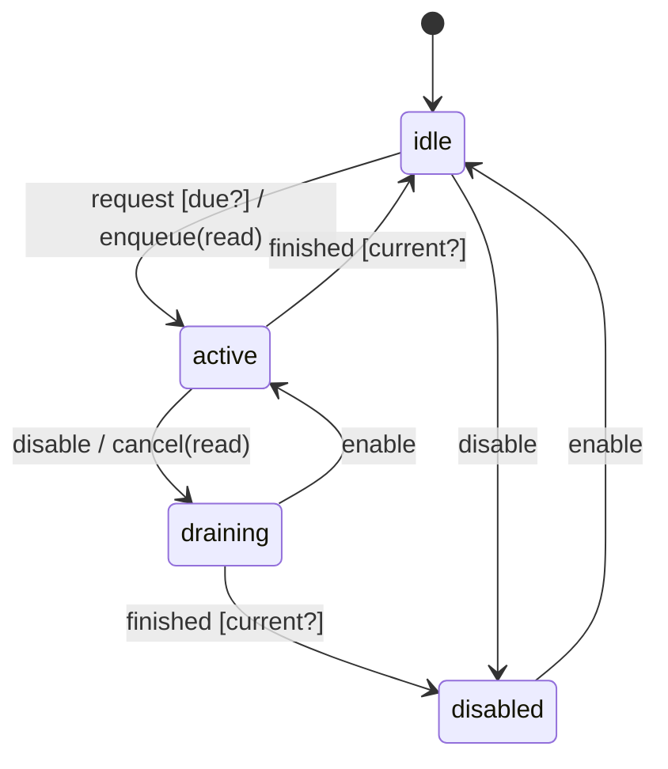

# schedule_machine

Generated by `mix board.fsm.docs`. Do not edit by hand.

| state | event | result | effects |
| --- | --- | --- | --- |
| idle | request [due?] | -> active | enqueue(read) |
| idle | request | ignored |  |
| idle | finished | ignored |  |
| idle | disable | -> disabled |  |
| idle | enable | ignored |  |
| active | request | ignored |  |
| active | finished [current?] | -> idle |  |
| active | finished | ignored |  |
| active | disable | -> draining | cancel(read) |
| active | enable | ignored |  |
| draining | request | ignored |  |
| draining | finished [current?] | -> disabled |  |
| draining | finished | ignored |  |
| draining | disable | ignored |  |
| draining | enable | -> active |  |
| disabled | request | ignored |  |
| disabled | finished | ignored |  |
| disabled | disable | ignored |  |
| disabled | enable | -> idle |  |
