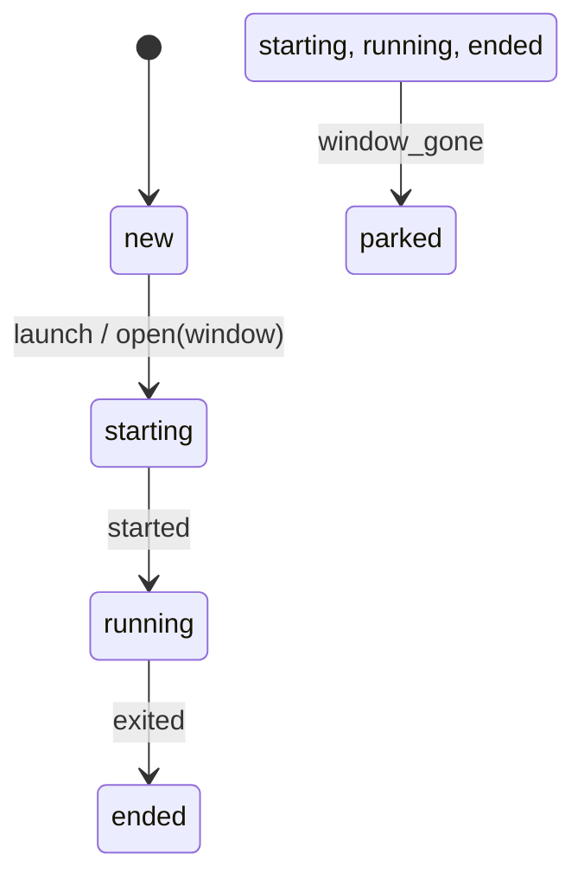

# session_machine

Generated by `mix foreman.fsm.docs`. Do not edit by hand.

| state | event | result | effects |
| --- | --- | --- | --- |
| new | launch | -> starting | open(window) |
| new | started | ignored |  |
| new | exited | ignored |  |
| new | window_gone | ignored |  |
| starting | launch | invalid |  |
| starting | started | -> running |  |
| starting | exited | ignored |  |
| starting | window_gone | -> parked |  |
| running | launch | invalid |  |
| running | started | ignored |  |
| running | exited | -> ended |  |
| running | window_gone | -> parked |  |
| ended | launch | invalid |  |
| ended | started | ignored |  |
| ended | exited | ignored |  |
| ended | window_gone | -> parked |  |
| parked | launch | invalid |  |
| parked | started | ignored |  |
| parked | exited | ignored |  |
| parked | window_gone | ignored |  |
