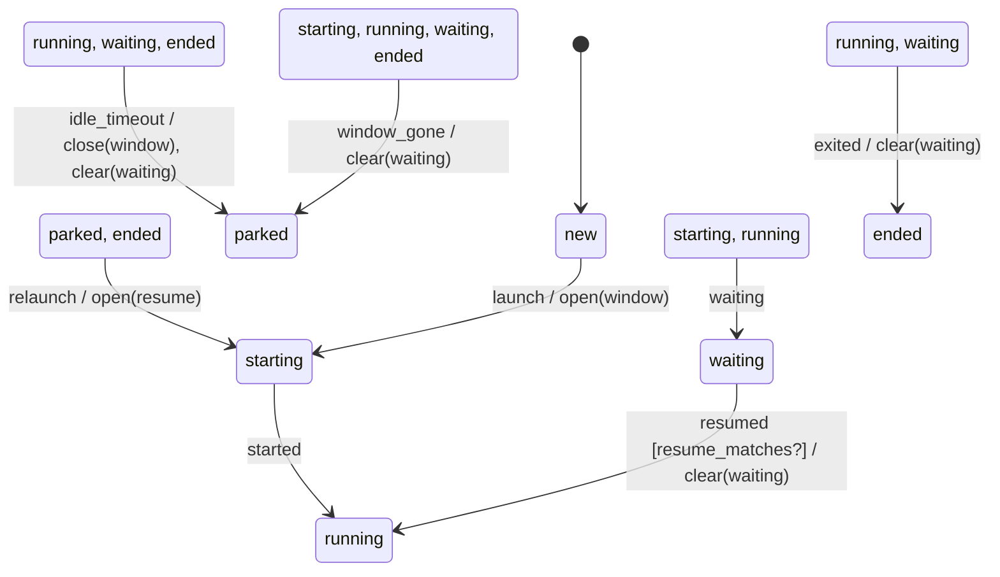

# session_machine

Generated by `mix foreman.fsm.docs`. Do not edit by hand.

| state | event | result | effects |
| --- | --- | --- | --- |
| new | launch | -> starting | open(window) |
| new | started | ignored |  |
| new | waiting | ignored |  |
| new | resumed | ignored |  |
| new | exited | ignored |  |
| new | window_gone | ignored |  |
| new | idle_timeout | ignored |  |
| new | activity | ignored |  |
| new | relaunch | invalid |  |
| starting | launch | invalid |  |
| starting | started | -> running |  |
| starting | waiting | -> waiting |  |
| starting | resumed | ignored |  |
| starting | exited | ignored |  |
| starting | window_gone | -> parked | clear(waiting) |
| starting | idle_timeout | ignored |  |
| starting | activity | ignored |  |
| starting | relaunch | invalid |  |
| running | launch | invalid |  |
| running | started | ignored |  |
| running | waiting | -> waiting |  |
| running | resumed | ignored |  |
| running | exited | -> ended | clear(waiting) |
| running | window_gone | -> parked | clear(waiting) |
| running | idle_timeout | -> parked | close(window), clear(waiting) |
| running | activity | ignored |  |
| running | relaunch | invalid |  |
| waiting | launch | invalid |  |
| waiting | started | ignored |  |
| waiting | waiting | ignored |  |
| waiting | resumed [resume_matches?] | -> running | clear(waiting) |
| waiting | resumed | ignored |  |
| waiting | exited | -> ended | clear(waiting) |
| waiting | window_gone | -> parked | clear(waiting) |
| waiting | idle_timeout | -> parked | close(window), clear(waiting) |
| waiting | activity | ignored |  |
| waiting | relaunch | invalid |  |
| ended | launch | invalid |  |
| ended | started | ignored |  |
| ended | waiting | ignored |  |
| ended | resumed | ignored |  |
| ended | exited | ignored |  |
| ended | window_gone | -> parked | clear(waiting) |
| ended | idle_timeout | -> parked | close(window), clear(waiting) |
| ended | activity | ignored |  |
| ended | relaunch | -> starting | open(resume) |
| parked | launch | invalid |  |
| parked | started | ignored |  |
| parked | waiting | ignored |  |
| parked | resumed | ignored |  |
| parked | exited | ignored |  |
| parked | window_gone | ignored |  |
| parked | idle_timeout | ignored |  |
| parked | activity | ignored |  |
| parked | relaunch | -> starting | open(resume) |
