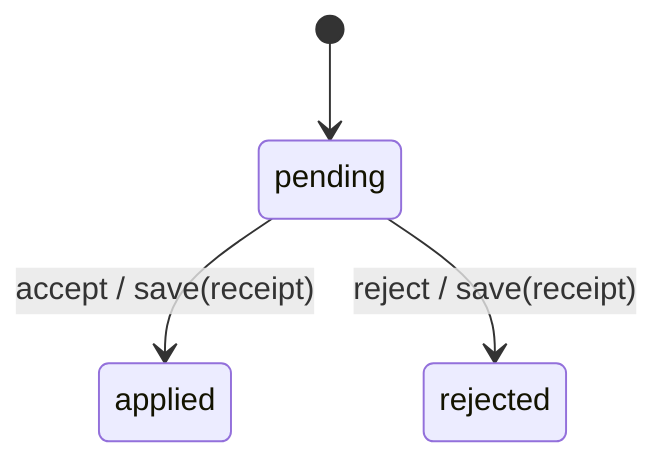

# spool_machine

Generated by `mix foreman.fsm.docs`. Do not edit by hand.

| state | event | result | effects |
| --- | --- | --- | --- |
| pending | accept | -> applied | save(receipt) |
| pending | reject | -> rejected | save(receipt) |
| pending | retry | ignored |  |
| applied | accept | ignored |  |
| applied | reject | ignored |  |
| applied | retry | ignored |  |
| rejected | accept | ignored |  |
| rejected | reject | ignored |  |
| rejected | retry | ignored |  |
