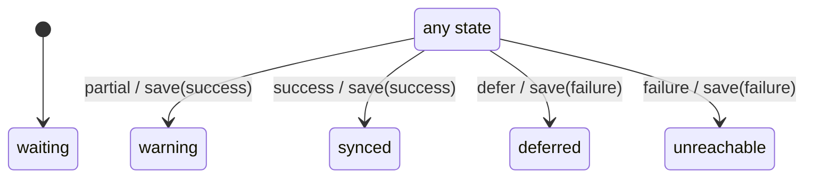

# sync_machine

Generated by `mix foreman.fsm.docs`. Do not edit by hand.

| state | event | result | effects |
| --- | --- | --- | --- |
| waiting | success | -> synced | save(success) |
| waiting | defer | -> deferred | save(failure) |
| waiting | failure | -> unreachable | save(failure) |
| waiting | partial | -> warning | save(success) |
| synced | success | -> synced | save(success) |
| synced | defer | -> deferred | save(failure) |
| synced | failure | -> unreachable | save(failure) |
| synced | partial | -> warning | save(success) |
| deferred | success | -> synced | save(success) |
| deferred | defer | -> deferred | save(failure) |
| deferred | failure | -> unreachable | save(failure) |
| deferred | partial | -> warning | save(success) |
| unreachable | success | -> synced | save(success) |
| unreachable | defer | -> deferred | save(failure) |
| unreachable | failure | -> unreachable | save(failure) |
| unreachable | partial | -> warning | save(success) |
| warning | success | -> synced | save(success) |
| warning | defer | -> deferred | save(failure) |
| warning | failure | -> unreachable | save(failure) |
| warning | partial | -> warning | save(success) |
