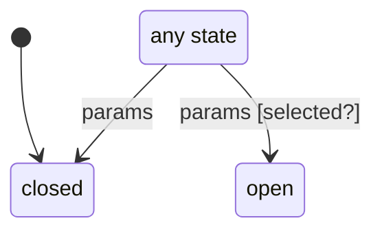

# ticket_sheet

Generated by `mix board.fsm.docs`. Do not edit by hand.

| state | event | result | effects |
| --- | --- | --- | --- |
| closed | params [selected?] | -> open |  |
| closed | params | -> closed |  |
| open | params [selected?] | -> open |  |
| open | params | -> closed |  |
