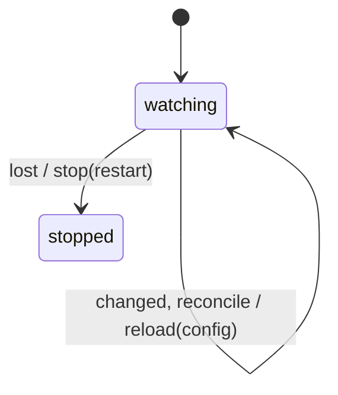

# watch_machine

Generated by `mix board.fsm.docs`. Do not edit by hand.

| state | event | result | effects |
| --- | --- | --- | --- |
| watching | lost | -> stopped | stop(restart) |
| watching | changed [directory_moved?] | stay | watch(replace), reload(config) |
| watching | changed | stay | reload(config) |
| watching | reconcile [directory_moved?] | stay | watch(replace), reload(config) |
| watching | reconcile | stay | reload(config) |
| stopped | lost | ignored |  |
| stopped | changed | ignored |  |
| stopped | reconcile | ignored |  |
