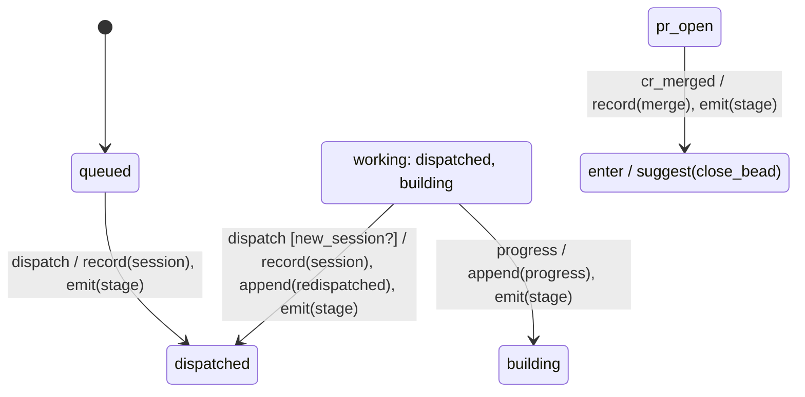

# bb-c2w.3 build report

## Result

Implemented the Phoenix scaffold and `Board.Fsm`. Stage and epic remain test fixtures, not application machines. No database was created, migrated, queried, or started by this session. No commits, pushes, beads commands, or subagents.

The generated files are present under `docs/machines/` for the coordinator to commit with the implementation.

## DSL reference

```elixir
defmodule Example do
  use Board.Fsm, observed_never_invalid: true

  initial :idle
  state :idle
  state :active, enter: [emit: :entered]
  event :start, source: :claimed
  event :refresh, source: :observed
  effects [:emit]
  guard :ready?

  transition :start, from: :idle, to: :active, guard: :ready?,
    do: [emit: :started]
  ignore :refresh, from: :any
  invalid :start, from: :any

  def ready?(_, %{ready: true}), do: true
  def ready?(_, _), do: false
end
```

`Example.step(:idle, {:start, %{ready: true}}, %{})` returns `{:active, [emit: :started, emit: :entered]}`.

- `initial` names exactly one declared state.
- `state` accepts `enter:` and `exit:` keyword effect lists.
- `group :working, [:dispatched, :building]` declares a named state set.
- `event` accepts `source: :claimed` or `:observed`. The default is `:claimed`.
- `guard :ready?` requires a public `ready?/2` function. Arguments are data and payload; atom events supply a `nil` payload.
- `effects [:emit, :record]` declares the names allowed in effect tuples. Arguments are static data, not executed callbacks.
- `transition` accepts `from:`, `to:`, `guard:`, and `do:`. `from:` accepts a state, group, state list, or `:any`; `to:` accepts a state or `:stay`.
- Event selectors accept an atom, list, or `:any`. `ignore` and `invalid` accept `from:` and an optional guard, but no effects.
- Names are lowercase snake-case atoms. Guards, events, and effects may end in `?` or `!`. `:any`, `:stay`, `nil`, booleans, and the `fsm_` prefix are reserved. State and group names cannot collide.

Resolution orders candidates by state specificity, then event specificity, then declaration order. A single name outranks a group or list, which outranks `:any`. The first guard returning `true` wins; every pair ends with an unguarded fallback.

`step/3` returns `{next_state, effects}` or `{:error, {:invalid, original_state, original_event}}`. Ignore returns `{state, []}`. Unknown or malformed state/event inputs return invalid. Effects run in exit, row, entry order. Explicit self-transitions and `:stay` produce only row effects. The library does not execute effects or mutate data.

Guards must be pure boolean functions, total over the caller's data and payload domain. Arbitrary Elixir guard functions cannot be proven pure or total by this macro; their exceptions are not swallowed. Both fixture machines handle arbitrary data and payload terms, as exercised by StreamData. Reachability assumes guards are satisfiable and uses only candidates before the unguarded cutoff.

`__fsm__/1` supports `:initial`, `:states`, `:events`, `:groups`, `:rows`, `:sources`, `:state_effects`, and `:choices`. States and events retain declaration order. Rows retain source file and line. Choices map each pair to its effective guarded alternatives and fallback.

`to_mermaid/0` and `matrix/0` return strings. The diagram draws named group transitions once and omits group stay arrows. The matrix expands every state/event pair, guarded alternatives, and effective exit/row/entry effects.

```sh
mix board.fsm.docs
# Or select machines explicitly:
MIX_ENV=test mix board.fsm.docs Board.Fixtures.Stage Board.Fixtures.Epic
```

The task defaults to the test environment so it can discover the two fixtures. It compiles without starting the application, rejects unknown module arguments without creating atoms, checks output-name collisions, and writes `docs/machines/<name>.md`.

## Compile checks and exact fixture messages

Every row below has a module compiled through `Code.compile_string/2` in `test/board/fsm_compile_test.exs`. Tests assert the exact `CompileError.description`, source filename, and a positive source line.

| Check | Exact messages exercised |
| --- | --- |
| Undeclared names | `fsm: undeclared state :missing`; `fsm: undeclared state or group :missing`; `fsm: undeclared event :missing`; `fsm: undeclared guard :ready?`; `fsm: undeclared effect :emit` |
| Missing or duplicate initial; duplicate declarations | `fsm: exactly one initial is required (got 0)`; `fsm: exactly one initial is required (got 2)`; `fsm: duplicate state :idle`; `fsm: duplicate event :go`; `fsm: duplicate group :g` |
| Missing guard function | `fsm: guard :ready? requires public def ready?/2` |
| Uncovered pair | `fsm: no row for (:idle, :go); add a transition, ignore or invalid` |
| All-guarded pair | `fsm: every row for (:idle, :go) is guarded; add an unguarded fallback` |
| Duplicate rows | `fsm: duplicate rows for (:idle, :go) with equal rank and guard` |
| Dead row | `fsm: dead row; earlier or more specific rows decide every pair it names` |
| Unreachable state | `fsm: state :other is unreachable from :idle` |
| Effects on ignore or invalid | `fsm: ignore/invalid rows cannot have effects` |
| Observed event declared invalid, with option enabled | `fsm: observed event :go cannot be invalid` |

The undeclared-name fixtures also cover the initial state, destination, group member, and entry effect. Missing-function fixtures cover an absent function and a private function. Both ignore and invalid have effect-rejection fixtures. The observed rule checks declarations even if another row would shadow them.

Additional declaration fixtures in `test/board/fsm_declarations_test.exs` assert:

```text
fsm: effects must be a keyword list of {name, argument} tuples
fsm: unknown transition option :gaurd
fsm: event source must be :claimed or :observed
fsm: invalid state name :any
fsm: invalid event name nil
fsm: group :idle conflicts with a state
fsm: group requires a non-empty list of state names
fsm: selector requires a non-empty list of names
fsm: duplicate transition option :to
```

## Stage and epic fixtures

`test/support/machines/stage.ex` follows Decision 7, including `cr_*` event names, broadcasts on every transition, re-dispatch and other-open-CR guards, and the merged entry suggestion. `test/support/machines/epic.ex` follows Decision 8. Its `:new_draft` initial state represents the table's pre-create origin. The `ticket` guard requires a nonempty beads epic id.

Backfill, persistence, and child-derived epic display are adapter work for later tickets. No new backfill events were added to either table.

Excerpt from `docs/machines/stage.md`:



| state | event | result | effects |
| --- | --- | --- | --- |
| building | dispatch [new_session?] | -> dispatched | record(session), append(redispatched), emit(stage) |
| building | dispatch | invalid |  |
| pr_open | cr_merged | -> merged | record(merge), emit(stage), suggest(close_bead) |
| abandoned | cr_merged | ignored |  |

The full stage matrix covers 130 pairs plus three guarded alternatives. Epic covers 56 pairs plus one guarded alternative.

## Test evidence

- Initial validation test failed against the stub with `Expected exception CompileError but nothing was raised`, then passed.
- The compile-check slice had 21 failures out of 23 fixtures before implementing the remaining checks; all now pass.
- Step tests failed three assertions against an always-invalid stub, then passed with ordered effects and resolution implemented.
- Renderer tests failed four tests against empty renderers and absent goldens, then passed.
- Replacing ignore's result with invalid caused both observed-event properties to fail and shrink to ignored observed pairs. Restoring ignore fixed them.
- Replacing the stage golden heading caused one golden test failure. Regeneration restored it.
- Malformed-declaration regressions failed all ten fixtures before validation was tightened; all now pass.

## Standards review

Reviewed the working tree and new files against `e6cf1a0335bc077e31b80a0da4a644c1781bac25`, using the root house rules, generated Phoenix `AGENTS.md`, formatter config, and Standards baseline. There are no commits after the base; the user explicitly requested review of this uncommitted implementation.

Important, fixed: the generated `README.md` replaced the project's spec/design links. Restored the project description and links, and documented the database-free gates and DSL commands.

Minor, left unchanged: Phoenix-generated explanatory comments and default assets remain as scaffold output. Removing them would be unrelated cleanup. The plain scaffold is intentional; the approved product UI is outside this ticket.

No Critical findings. Declined to judge product UI styling and Fluxon integration because they belong to later tickets. Final verdict: ready.

## Spec review

Checked bb-c2w.3 acceptance, spec Decision 6, and the Decision 7/8 fixture tables after the Standards pass.

Important, fixed: `effect_names!/3` originally skipped malformed entries such as `do: [:emit]`. The compiler now rejects malformed effect lists, unknown or duplicate option keys, invalid event sources, reserved names, empty selectors/groups, and state/group collisions. Regression fixtures cover these cases.

The ten required checks, pure step API, introspection, documentation task, full matrices, goldens, and properties are implemented. The stage fixture uses the authoritative spec's CR names and broadcasts rather than copying the older prototype unchanged.

No Critical findings. No open Important findings. Declined to judge application machine wiring, backfill execution, child-derived epic display, and merge-action implementation; those are later tickets. Final verdict: ready.

## Risk review

Ran after the Spec pass. The public boundary is a compiled table consumed by both runtime and documentation. The runtime consults the same resolved candidates that coverage, dead-row detection, and reachability validate.

Important, fixed: `config/runtime.exs` inherited the generator's all-interface production bind. It now binds `127.0.0.1`, consistent with the local-only spec. A `Config.Reader` probe evaluated production config without starting the app and asserted the loopback tuple.

Safety proof, level 4, executed through `MIX_ENV=test mix run --no-start`:

```text
Safety proof: all 186 fixture pairs stepped; observed never invalid; option false works; caller attribute unchanged; Repo absent
Compile probe: 40 states, 20 events, 40 rows: 756 ms
Production endpoint binds loopback
```

The probe also compiled a separate machine with `observed_never_invalid: false`, checked its explicit invalid result, and checked that an unrelated caller module attribute survived macro expansion. The production fixture modules are not compiled into the development application. No existing application callers needed migration.

Residual limits: guard purity and totality require author discipline. Large Cartesian products increase compile time and generated table size; the 800-pair probe is a scale check, not a performance guarantee. Mermaid text and golden contents were tested, but no browser-rendered Mermaid layout was inspected. No Critical or Important findings remain. Final verdict: ready.

## Final gates

Fresh commands, all exited 0 with no warnings:

```text
mix format --check-formatted
mix compile --warnings-as-errors
mix precommit
Running ExUnit with seed: 278666, max_cases: 16
4 properties, 50 tests, 0 failures

mix board.fsm.docs
Generated docs/machines/epic.md
Generated docs/machines/stage.md

mix test test/board/fsm_docs_test.exs
Running ExUnit with seed: 28878, max_cases: 16
4 tests, 0 failures

git diff --check
```

Elixir 1.19 initially warned about the manually loaded probe fixture. It now uses the default-ignored `_helper.exs` suffix; the final gate above is warning-free. The naming rule is recorded in `README.md`.

Changed: the Phoenix scaffold, compile-checked FSM library, test fixtures, compile-fail/step/property/golden tests, documentation task, and generated stage/epic docs.

Verified: the commands and results above, plus production loopback and macro/scale probes.

Not verified: Postgres-backed application behavior, a running release, and browser UI. They are outside this library ticket, and database access was explicitly prohibited.
