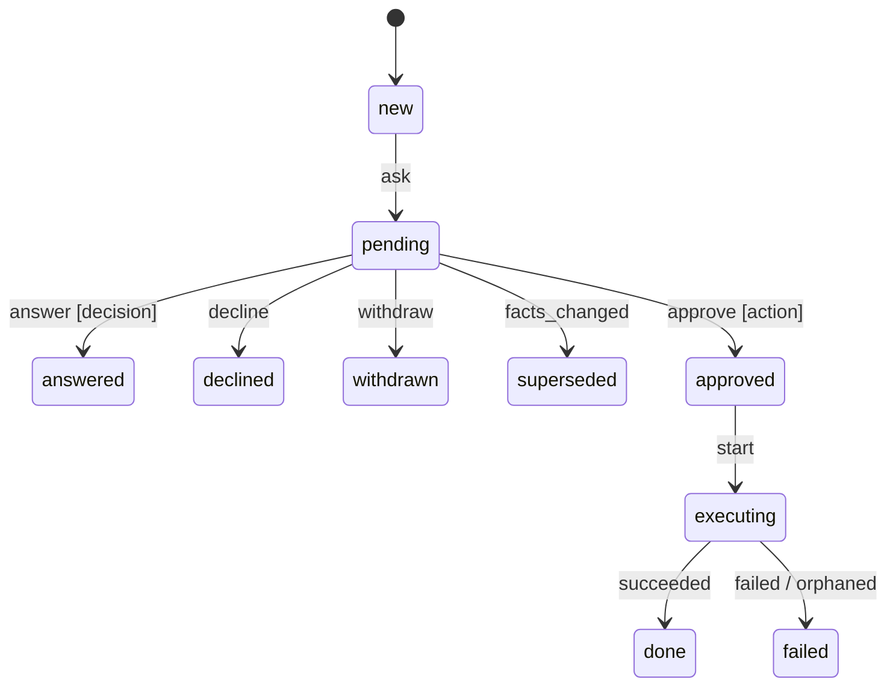

# bb-inbox: bb-zgd.1

Implemented and verified on branch `bb-inbox`. No commits, pushes, bd commands, or subagents. The coordinator owns ticket closure. The installed service on port 4747 was untouched. The temporary server on port 4771 is stopped.

## Changes

- `Board.Requests` stores asks and outcomes in Postgres, with immutable facts, asker actor/session, timestamps, and a transition audit. Migration: `priv/repo/migrations/20261018171858_create_approval_requests.exs`.
- `Board.Request` declares the full request lifecycle. Only the decision kind is registered. `Kind.validate/2` validates creation facts; `Kind.enqueue/1` is the transactional extension point for later action jobs. Decisions cannot approve or enqueue work. Later action jobs must supply their own live guards, one-shot execution claims, and rescue handling.
- Ask, answer, decline, and ticket completion share the overlay's per-repository transaction lock. Concurrent resolutions produce one outcome. Ticket abandonment or completion supersedes pending asks in the same transaction. Ticketed drafts retain asks made under either epic identity.
- `board ask decision` returns a UUID. `board wait` polls through a separate declared machine and returns JSON on resolution or timeout. Both exit 0 on handled failures. The envelope UUID is the request UUID, including after offline replay. The CLI contract is documented in [bb-cli.md](bb-cli.md#decision-requests-bb-zgd1).
- `/needs-you` lists pending decisions oldest first, with options, recommendation, one optional Note field, and adjacent Answer/Decline buttons. Answer stores the selected option and note; without an option, the note becomes the answer. Decline stores the note. Recent outcomes start collapsed. Existing pending cards stay mounted during reconciliation so incoming requests cannot erase an unfinished answer.
- Every board page has Needs you first in the sidebar and shares the live pending count. The title is `(N) beads-board`, or `beads-board` when empty. Notifications use the existing Postgres invalidations, with three-second reconciliation for missed messages. No browser notification permission or notification code was added.
- The shared ticket sheet has a Requests tab. At narrow widths, the existing History and Notes labels use their short forms so all five tabs remain visible.

## Machine

Generated golden diagram and exhaustive matrix: [request machine](../machines/request.md). The [wait machine](../machines/request_wait.md) declares polling, completion, and timeout.

| From | Event | To | Effects |
| --- | --- | --- | --- |
| new | ask | pending | record request, notify pending |
| pending | approve, action kind | approved | enqueue job |
| pending | answer, decision | answered | record answer, notify asker |
| pending | decline | declined | record note, notify asker |
| pending | withdraw | withdrawn | none |
| pending | facts_changed | superseded | notify asker |
| approved | start | executing | audit intent |
| executing | succeeded | done | audit result, notify asker |
| executing | failed | failed | audit reason, notify asker |
| executing | orphaned | failed | audit unknown outcome, notify asker |
| all other pairs | claimed event | invalid | none |
| all other pairs | observed event | unchanged | none |



The machine tests cover every transition, wrong-kind claims, and every remaining declared state/event pair. The action branches are tested as pure transitions; this ticket does not register push, open_pr, or merge handlers.

## Shell and browser transcript

`tools/inbox-acceptance.exs` uses `beads_board_acceptance_bb-inbox`, a synthetic Postgres ticket, no beads reader, and port 4771. `tools/inbox-acceptance.cjs` invokes this checkout's actual escript, starts waiting processes before clicking the browser controls, and checks their results. Actor/session are `pi` and `bb-inbox`. It does not install the CLI.

The excerpt below records the initial run. The coordinator-correction section records the replacement run; [transcript.json](../acceptance/bb-inbox/transcript.json) retains its complete JSON responses and exit codes.

```text
$ board ask decision scratch-1 --project scratch \
    --question "Which layout should the build use?" \
    --option Wide --option Compact --recommendation Compact \
    --text "Keep the existing keyboard shortcuts."
3c18537f-772e-4dc4-8ed7-9059de0aaf74

$ board wait 3c18537f-772e-4dc4-8ed7-9059de0aaf74 --timeout 0
{"state":"pending","outcome":{},"note":null,...}

$ board wait 3c18537f-772e-4dc4-8ed7-9059de0aaf74 --timeout 60
[Browser: selected Compact, clicked Answer]
{"state":"answered","outcome":{"answer":"Compact"},"note":null,...}

$ board ask decision scratch-1 --project scratch \
    --question "Include the optional animation?" \
    --option Include --option Skip --recommendation Skip
114ef09b-1f73-4578-b1de-772fe7b0ca5d

$ board wait 114ef09b-1f73-4578-b1de-772fe7b0ca5d --timeout 60
[Browser: entered "Keep this slice focused.", clicked Decline]
{"state":"declined","outcome":{},"note":"Keep this slice focused.",...}

$ board ask decision scratch-1 --project scratch --question "Continue this build?"
8169e8fd-c7f6-491f-9b60-d9bf5278715e
$ board wait 8169e8fd-c7f6-491f-9b60-d9bf5278715e --timeout 60
[Second shell: board abandon scratch-1 --project scratch]
{"state":"superseded","outcome":{"reason":"ticket_finished"},...}
```

Every command exited 0. The acceptance database contained [zero Oban jobs](../acceptance/bb-inbox/no-jobs.txt). Declining executed nothing. Separate real-escript checks with HTTP and Postgres both unavailable returned warnings and exit 0: [unavailable.json](../acceptance/bb-inbox/unavailable.json).

## Browser evidence

The final runner passed pending order, option preservation across an incoming notification, answer, decline note, timeout, superseding, two-tab counts/titles, the Requests tab, and zero browser errors. Full output: [browser.txt](../acceptance/bb-inbox/browser.txt).

All eight final layout captures were opened and inspected. Inputs have visible boundaries, sidebar counts have contrast, Answer and Decline share one row beneath Note, and the selected Requests tab fits at 390 px. No document overflow or overlapping controls appeared.

| View | 1440 light | 1440 dark | 390 light | 390 dark |
| --- | --- | --- | --- | --- |
| Needs you | [capture](../acceptance/bb-inbox/inbox-1440-light.png) | [capture](../acceptance/bb-inbox/inbox-1440-dark.png) | [capture](../acceptance/bb-inbox/inbox-390-light.png) | [capture](../acceptance/bb-inbox/inbox-390-dark.png) |
| Requests | [capture](../acceptance/bb-inbox/requests-1440-light.png) | [capture](../acceptance/bb-inbox/requests-1440-dark.png) | [capture](../acceptance/bb-inbox/requests-390-light.png) | [capture](../acceptance/bb-inbox/requests-390-dark.png) |

[Expanded outcomes](../acceptance/bb-inbox/outcomes.png) records the answered and declined cards.

UI implementation facts for later tickets: resetting a stream of editable cards erased radio selections in the real browser. Preserve unchanged pending cards. The stock core input classes do not supply the app's Fluxon styling; these inputs need explicit border, background, padding, and focus classes. Whitespace-preserving text also needs inline HEEx content to avoid displaying template indentation.

## Review scope

Baseline `7118b8b4ebd72fc9f4037dcecbe6593c6b65b28b` is HEAD. The committed three-dot diff and commit list are empty. The requested self-review covers the working-tree diff and new deliverables, excluding the coordinator-owned brief. Axes ran sequentially in this session without subagents.

### Standards

Reviewed against root/app AGENTS and the house baseline, including the binding state-machine rule.

The request and polling lifecycles use `Board.Fsm`. Neither HTTP nor the CLI accepts worker observations as agent commands. The pending-card ID set is rendering data, not another workflow state. Ticket tabs remain URL data; native details disclosure has no server-side mode. Collections use streams and times use the shared formatter. No dependency, atoms from user input, or beads writes were added.

The initial invisible form fields and low-contrast count were fixed with explicit input and badge styling. A comment describing the internal request interpreter became its API doc. No Critical or Important Standards finding remains.

Declined to judge: existing page navigation styling and unrelated workflow machines. Verdict: ready.

### Spec

Reviewed against bb-zgd.1 and Decisions 1, 7, 8, 9, and the in-app portion of 10.

Important findings fixed:

- `lib/board_web/live/needs_you_live.ex:48`: resetting pending streams discarded an unfinished option selection. The browser assertion failed before incremental insertion/deletion replaced resets. The final runner preserves the selection across a new ask.
- `lib/board_web/components/ticket_detail.ex`: the fifth tab was selected but off-screen at 390 px. Short responsive labels and tighter spacing keep Requests visible. The browser now asserts its bounds.

The request table, all machine rows, validation, immediate ask ID, JSON wait, timeout, answer, decline note, pending count, Requests tab, and superseding are covered. Free-text answers have a LiveView test; recommended-option answers have the shell/browser transcript. Recent outcomes also include answered and withdrawn decisions rather than hiding those terminal outcomes.

Declined to judge: action kinds, OS notifications, and skill wiring, which belong to later tickets. Verdict: ready. No open Critical or Important Spec finding.

### Risk

The safety fact is that request transitions and ticket completion use the same transaction lock. A successful resolution records its audit with the outcome, and an idempotent ask records its receipt in that transaction. Decisions never enqueue jobs.

Important findings fixed:

- `lib/board/requests.ex:22`: an offline ask initially acquired a new UUID on replay, different from the spool receipt. The failing-first regression now requires the envelope UUID to identify the request. Replay tests prove the known ID resolves to one pending request after repeated replay.
- `lib/board/requests.ex:65`: linking a draft to an existing epic hid requests posted under the old epic identity and missed them during completion. A failing regression now verifies both aliases remain listed and both pending requests become superseded when the epic closes.

Proof level 4: independent committed connections race answer against decline and ask against ticket completion. The tests assert one terminal audit/outcome and no pending request after completion. Proof level 5: real escripts, the browser, two open tabs, and the zero-job database audit.

Cleared: duplicate asks, stale resolution clicks, unsupported action kinds, observed-event API submission, blank answers, late ticket completion, wait reads entering the spool, and nonzero exits when both services are unavailable. A mutation that let decisions approve failed two machine tests; it was restored before the final gate.

Declined to judge: external write safety of future kind handlers, service deployment, other browser engines, and long-running endurance. A wait deadline can overrun by one bounded HTTP call; this is documented. Requests are durable, so a caller can wait again after timeout or transport failure. Verdict: ready. No open Critical or Important Risk finding.

## Test-first evidence and limits

- Machine, request persistence, ask API/CLI, and page tests were written before implementation. The machine stub failed on the first expected transition. Request and API tests failed on returned values. The page tests were rerun against an empty routed LiveView to get assertion-level failures before implementation.
- Ticket superseding, decline-note persistence, invalid kind/facts, and page answer/decline were in those initial tests.
- The unfinished-option browser regression, stable-ID regression, and epic-alias regression failed before their fixes.
- Concurrency, blank-answer, wait-machine, and several failure-path checks were added after their implementation. They are regression evidence, not a complete failing-first trail.
- [Mutation output](../acceptance/bb-inbox/mutation-machine.txt) records two expected failures when the decision/action approval guard was reversed. The mutation is absent from the final code.

## Final gates

[Precommit output](../acceptance/bb-inbox/precommit.txt):

```text
mix precommit
Repository hygiene: no license material or operator paths detected
4 properties, 308 tests, 0 failures
exit 0
```

```text
MIX_ENV=acceptance mix assets.build
Tailwind and esbuild completed successfully

NODE_PATH=<Playwright modules> node tools/inbox-acceptance.cjs
PASS: real ask/wait, browser answer and decline with note; two live tabs;
pending order; draft input preserved; light/dark × 390/1440;
Requests tab; no browser errors

Real ask/wait subprocesses with HTTP and Postgres unavailable
PASS: both exit 0 with warnings

Acceptance audit
%{database: "beads_board_acceptance_bb-inbox", jobs: 0}

git diff --check
clean
```

Unit tests use `beads_board_test_bb-inbox`; acceptance uses a separate committed-fixture database. The final acceptance run started from that checkout's fresh acceptance database. No shared or installed-board database was reset. Initial dependency compilation emitted the existing Oban unused-clause warning; final application gates emitted no warnings.

Changed: the durable decision inbox, agent ask/wait, live counts, and ticket requests.
Verified: the tests, browser captures, subprocess transcript, and gates above.
Not verified: installed-service migration/deployment, future action execution, and browser notifications. Those were not part of this build.

## Coordinator corrections

All three findings are resolved:

1. Removed centering from the pending list and recent outcomes. Their left edge now matches the heading, with a `max-w-3xl` content width. The browser checks the heading/list coordinates at both widths.
2. Each card now has one form: options, one optional textarea labelled Note, then adjacent Answer and Decline submit buttons. The clicked button supplies the action while both actions submit the same fields. An option answer retains its note separately; without an option, a non-empty note is the answer. A note-only answer appears once in the outcome card rather than repeating as both answer and note.
3. Renamed the machines to `Board.Request` and `Board.RequestWait`. Regenerated `docs/machines/request.md` and `docs/machines/request_wait.md`, updated references and golden tests, and removed the generic filenames.

The updated LiveView tests first failed against the two-form implementation. They now cover note-only answers, option-plus-note answers, decline notes, a single textarea, and the shared action row. The duplicate note-only outcome assertion also failed before its fix.

The replacement browser run uses actual submit buttons and waiting escripts. It checks that both the chosen option and note survive an incoming request. Returned outcomes include:

```text
624ba367-a4a8-4dcd-ae23-368a6e69f521
  answered; answer: Compact; note: Keep the shortcuts.
f43ac985-3a76-40b7-a768-000f463044cf
  declined; note: Keep this slice focused.
ed7fc17d-b1ac-4228-915a-5096cd1758d9
  answered; answer: Use the existing layout. (no option selected)
579e28b8-85e6-4197-af0e-ab9eb64ff5ec
  superseded; reason: ticket_finished
```

All exited 0. The refreshed browser runner passed in light/dark at 390/1440. Screenshots were opened and inspected for shared left edges, one Note field, adjacent actions, and outcome notes. No overflow or browser errors appeared. The acceptance database again contained zero jobs, and its port-4771 server is stopped.

Follow-up review ran Standards, then Spec, then Risk. The forms remain data, while resolution still uses the declared request machine. All requested UI changes and named goldens are present. Real-browser submitter handling and persisted answer/note separation passed. No open Critical or Important finding remains.

Prevention: I checked individual cards but missed the page-level alignment and accepted separate fields for one decision. Rung 2 adds executable browser assertions for shared left edges, exactly one text field, and equal button top coordinates, plus LiveView assertions for shared-note semantics. No lesson bead was created because this worktree's instructions prohibit bd commands.

Fresh final gate: `mix precommit`, seed 492732, **4 properties, 308 tests, 0 failures**. `git diff --check` is clean. The gate and browser output files above contain the replacement results.
